<p align="center">
  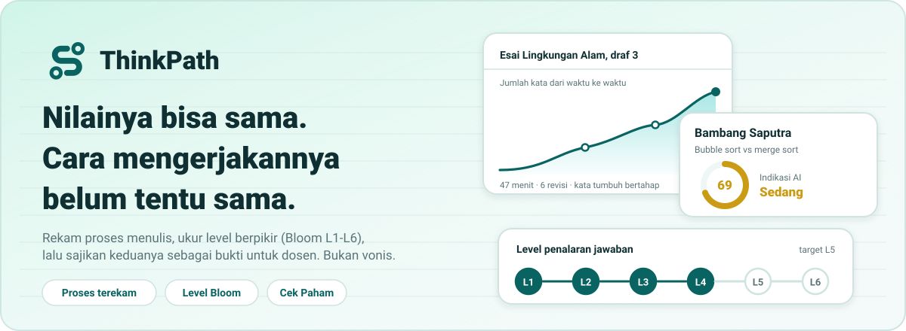
</p>

<p align="center">
  <a href="https://thinkpath.vercel.app"><b>thinkpath.vercel.app</b></a>
  &nbsp;·&nbsp; Next.js 15 &nbsp;·&nbsp; Django 5 &nbsp;·&nbsp; PostgreSQL 17
</p>

# ThinkPath

**Sistem Verifikasi Pemahaman Berbasis Proses untuk Integritas Akademik Mahasiswa.**

Detektor AI biasa memberi satu angka: "AI atau bukan". Angka itu bisa salah, dan mahasiswa jujur bisa tertuduh. ThinkPath bekerja beda. Ia merekam **proses** mengerjakan, mengukur **level berpikir** jawaban, lalu menyajikan keduanya sebagai **bukti** yang bisa ditinjau dosen. Bukan vonis. Keputusan tetap di tangan dosen.

**Lomba:** GEMASTIK XIX 2026, Pengembangan Perangkat Lunak
**Tim:** DataDigger, Universitas Bina Nusantara

---

## Daftar Isi

1. [Apa Itu ThinkPath?](#apa-itu-thinkpath)
2. [Coba Aplikasinya](#coba-aplikasinya)
3. [Masalah dan Solusi](#masalah-dan-solusi)
4. [Alur Kerja](#alur-kerja)
5. [Fitur Penting](#fitur-penting)
   - [Proses mengerjakan direkam](#1-proses-mengerjakan-direkam)
   - [Cara ThinkPath menganalisis indikasi AI](#2-cara-thinkpath-menganalisis-indikasi-ai)
   - [Level berpikir: Bloom L1 sampai L6](#3-level-berpikir-bloom-l1-sampai-l6)
   - [Bukti pendukung](#4-bukti-pendukung)
   - [Cek Paham: tes lisan singkat](#5-cek-paham-tes-lisan-singkat)
   - [Fitur lain](#6-fitur-lain)
   - [Seberapa akurat?](#seberapa-akurat)
6. [Tech Stack dan Arsitektur](#tech-stack-dan-arsitektur)
7. [Struktur Project](#struktur-project)
8. [Menjalankan di Lokal](#menjalankan-di-lokal)
9. [Tim](#tim)
10. [Link Terkait](#link-terkait)

---

## Apa Itu ThinkPath?

Dua mahasiswa mengumpulkan esai yang sama bagusnya. Satu menulis sendiri selama dua jam. Satu menempel hasil chatbot dalam dua menit. Nilainya bisa sama. **Cara mengerjakannya jelas beda.**

ThinkPath membantu dosen melihat beda itu:

- **Proses:** berapa lama, bagaimana jumlah kata bertambah, berapa kali revisi.
- **Level berpikir:** jawaban cuma menghafal, atau sudah menganalisis dan menilai?
- **Saran tindak lanjut:** perlu ditanya langsung? Perlu dibandingkan dengan jawaban lain?

Hasilnya: dosen tahu **siapa yang paling layak diajak bicara lebih dulu**. Bukan siapa yang paling mungkin curang.

> **Prinsipnya.** Tidak ada satu skor pun yang jadi vonis. Setiap penanda disertai bukti yang bisa dijelaskan dan dibantah. ThinkPath tidak memberi nilai dan tidak menjatuhkan sanksi.

---

## Coba Aplikasinya

<p align="center">
  <a href="https://thinkpath.vercel.app"></a>
</p>

Buka **https://thinkpath.vercel.app**, pilih peran **Dosen** atau **Mahasiswa**, lalu masuk dengan akun demo. Password semua akun: `thinkpath123`.

| Peran | Email | Yang bisa dicoba |
|---|---|---|
| Dosen | `dosen@thinkpath.local` | Budi Juarto: Algorithm & Programming, Operating System, Introduction to AI. 3 Cek Paham |
| Dosen | `dosen2@thinkpath.local` | Hendra Gunawan: Business Creation, banyak jawaban berupa PDF |
| Mahasiswa | `mhs01@thinkpath.local` sampai `mhs20@thinkpath.local` | 20 mahasiswa dengan cara mengerjakan berbeda. `mhs01` belum mengumpulkan tugas pekan ini, jadi bisa langsung mencoba. `mhs07` punya Cek Paham yang bisa dikerjakan |

Semua kelas sudah berjalan sampai pekan sesi ke-10: 12 materi dan 12 tugas per kelas, sebagian sudah dinilai, sebagian menunggu diperiksa, dan tugas pekan ini masih terbuka.

Akun baru: klik **Daftar**, centang persetujuan [Kebijakan Privasi](https://thinkpath.vercel.app/kebijakan-privasi), selesai. Aplikasi bisa dibuka di HP maupun laptop.

<table>
  <tr>
    <td width="50%">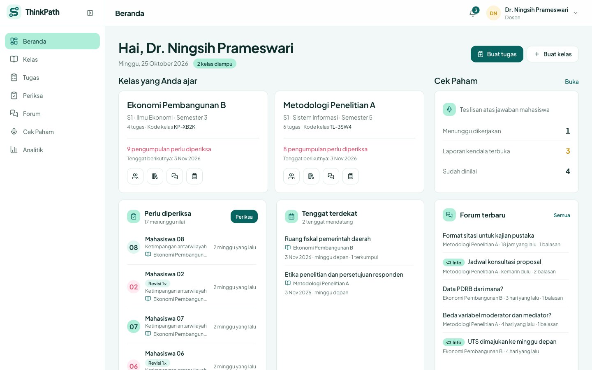<br><sub><b>Beranda dosen.</b> Kelas, antrean periksa, tenggat, forum.</sub></td>
    <td width="50%">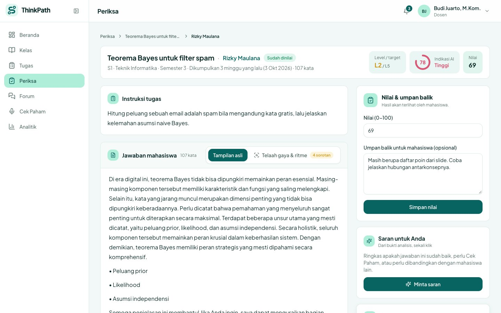<br><sub><b>Periksa satu jawaban.</b> Instruksi, jawaban, indikasi AI, level, nilai, saran.</sub></td>
  </tr>
  <tr>
    <td width="50%">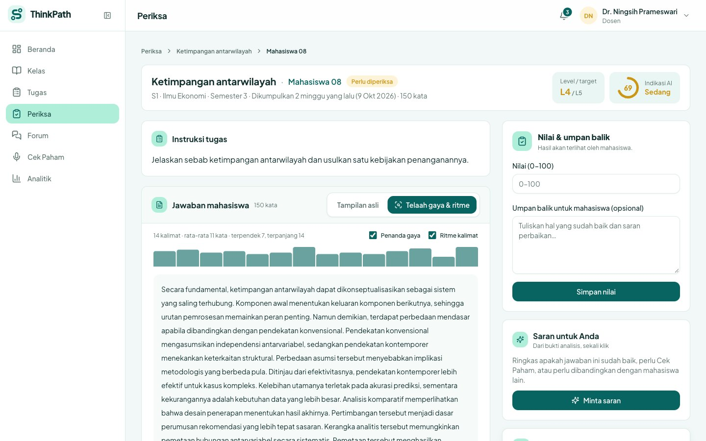<br><sub><b>Telaah gaya dan ritme.</b> Penanda gaya teks dan panjang kalimat dalam satu tampilan.</sub></td>
    <td width="50%">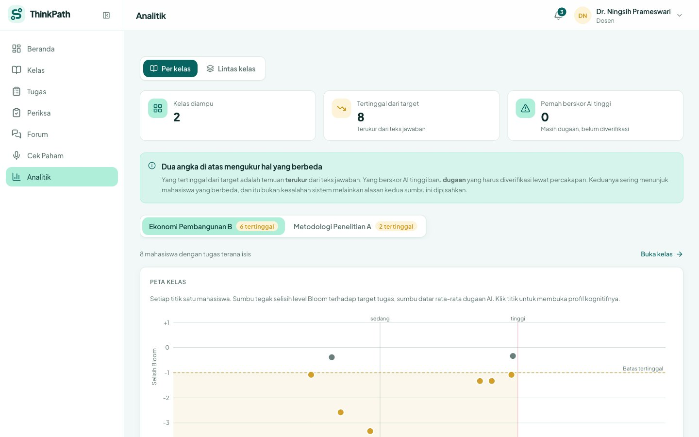<br><sub><b>Analitik kelas.</b> Peta dua sumbu: perlu bantuan atau perlu ditanya.</sub></td>
  </tr>
  <tr>
    <td width="50%">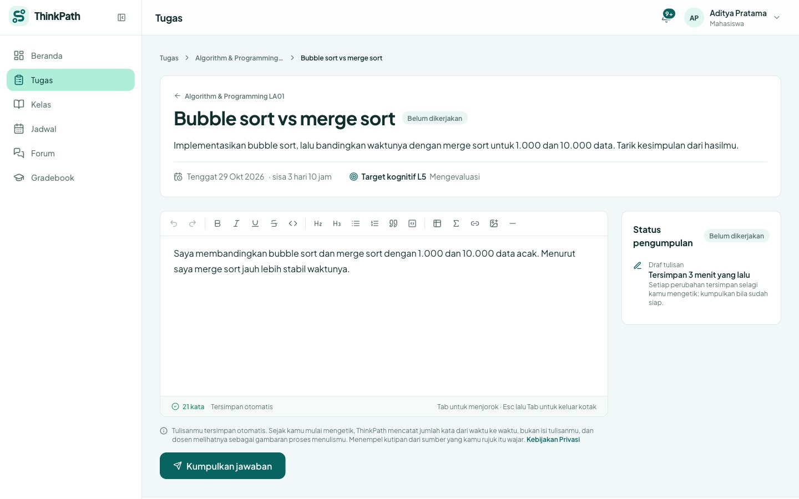<br><sub><b>Editor mahasiswa.</b> Tulisan kaya, simpan otomatis, mahasiswa tahu apa yang dicatat.</sub></td>
    <td width="50%">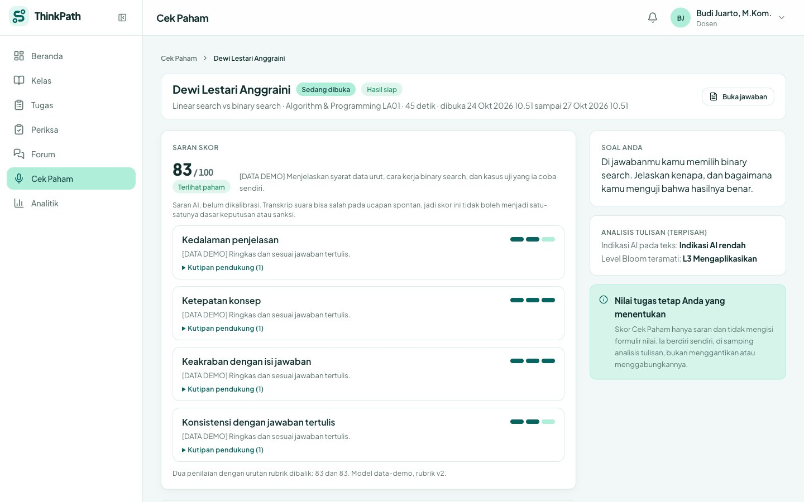<br><sub><b>Hasil Cek Paham.</b> Transkrip, saran skor, dan kutipan bukti.</sub></td>
  </tr>
</table>

<p align="center">
  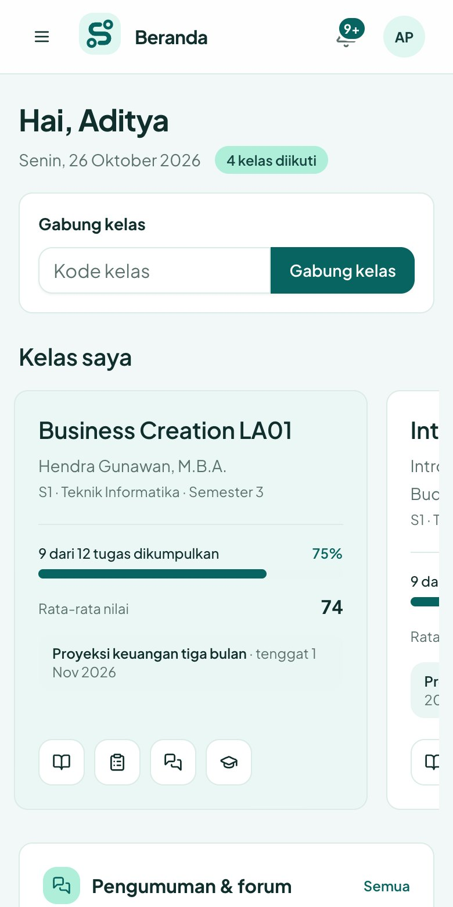
  &nbsp;&nbsp;
  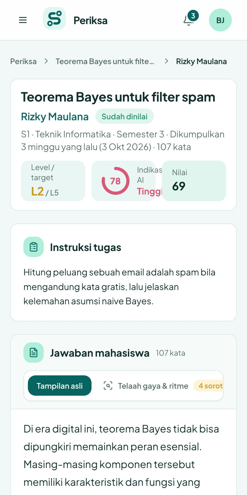
  &nbsp;&nbsp;
  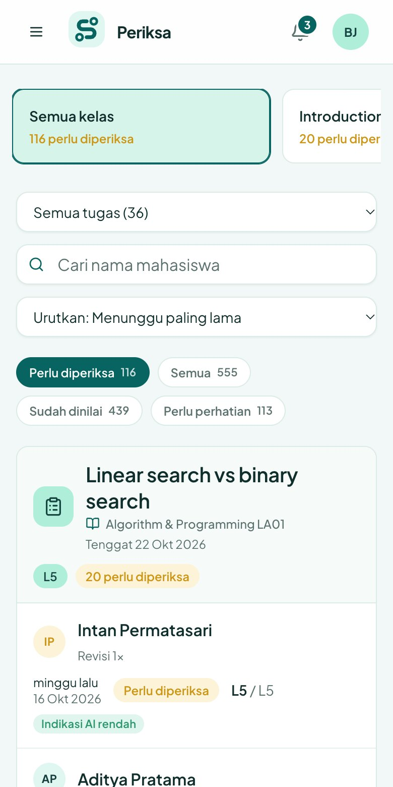
</p>

---

## Masalah dan Solusi

| Masalah | Solusi ThinkPath |
|---|---|
| Detektor AI memberi satu skor tanpa alasan. Mahasiswa jujur bisa tertuduh. | Skor selalu disertai **rincian sinyal dan bukti**. Dosen bisa menelusuri tiap poin. |
| Teks bisa diparafrase sampai lolos detektor. | **Proses mengerjakan** direkam server. Parafrase tidak mengubah fakta bahwa 400 kata muncul dalam dua menit. |
| Nilai bagus belum tentu paham. | **Level Bloom** menaksir seberapa dalam penalaran di jawaban, dibanding target dosen. |
| Dosen tidak tahu siapa yang harus ditanya lebih dulu. | **Antrean periksa** dan **saran satu klik**: sudah baik, perlu Cek Paham, atau perlu dibandingkan. |
| Mahasiswa sulit membela diri. | **Cek Paham**: tes lisan singkat. Mahasiswa menjelaskan jawabannya sendiri dengan suara. |
| Mahasiswa tidak tahu apa yang diawasi. | Form menjelaskan **hanya jumlah kata per 30 detik** yang dicatat, bukan isi ketikan. Skor AI tidak tampil di layar mahasiswa. |

---

## Alur Kerja

<p align="center">
  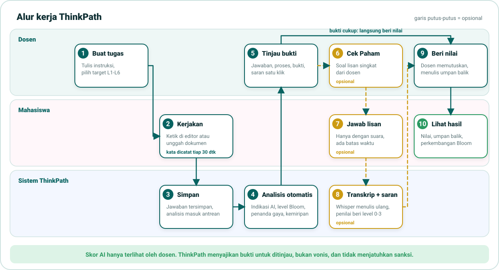
</p>

**Singkatnya:**

1. **Dosen** membuat kelas, membagikan kode gabung, lalu membuat tugas dan memilih target level Bloom.
2. **Mahasiswa** mengerjakan di editor, atau mengunggah dokumen (PDF, Word, foto). Proses mengerjakan terekam.
3. **Sistem** menyimpan jawaban lalu menganalisis di latar belakang: indikasi AI, level Bloom, penanda gaya, kemiripan.
4. **Dosen** meninjau bukti. Satu klik memberi saran: sudah baik, perlu Cek Paham, atau perlu dibandingkan.
5. **Opsional:** dosen meminta Cek Paham. Mahasiswa menjawab dengan suara. Dosen menerima transkrip dan saran skor.
6. **Dosen** memberi nilai dan umpan balik. Mahasiswa melihat nilai, umpan balik, dan perkembangan level berpikirnya.

---

## Fitur Penting

### 1. Proses mengerjakan direkam

Server mencatat kapan mahasiswa mulai menulis dan **jumlah kata tiap 30 detik** dari draf yang tersimpan otomatis. Itu saja.

| Direkam | Tidak direkam |
|---|---|
| Waktu mulai dan kumpul | Isi ketikan per detik |
| Jumlah kata tiap 30 detik | Tombol yang ditekan |
| Jumlah revisi | Tindakan menempel (menempel kutipan itu wajar) |
| Durasi | Layar, kamera, lokasi |

Dari kurva kata ini dosen melihat bentuk pengerjaan: **bertahap** (menulis sendiri) atau **sekali muncul** (ditempel). Jawaban yang diimpor dari dokumen tidak punya jejak mengetik, jadi proses tidak dinilai dan diberi tanda.

### 2. Cara ThinkPath menganalisis indikasi AI

Dua mesin, **saling bebas**. Level Bloom tidak pernah memengaruhi skor AI, dan itu dijaga uji otomatis.

<p align="center">
  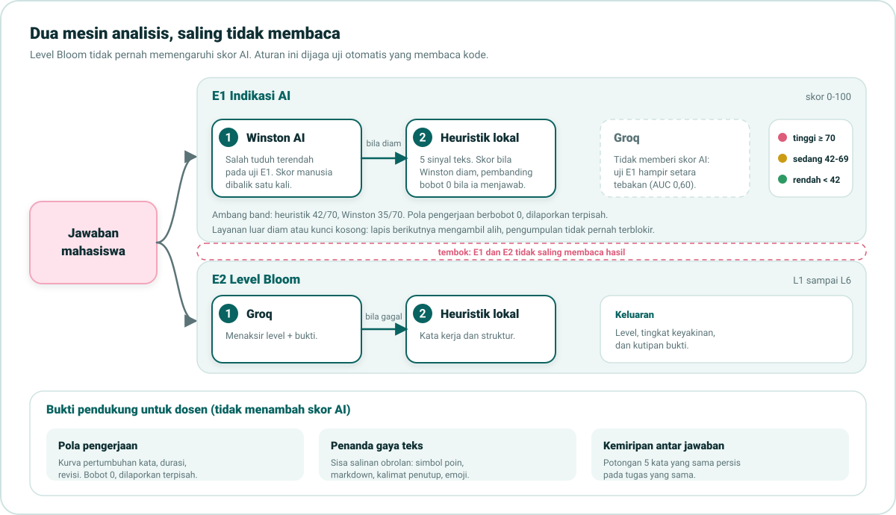
</p>

**Skor indikasi AI (0-100)** diambil dari tiga lapis. Kalau satu lapis gagal, lapis berikutnya mengambil alih. Pengumpulan tugas tidak pernah terblokir.

1. **Winston AI**, detektor eksternal. Ia memberi skor "manusia", jadi ThinkPath membaliknya tepat satu kali.
2. **Groq**, model bahasa yang menilai probabilitas AI.
3. **Heuristik lokal**, lima sinyal teks yang dihitung di server sendiri.

Skor lalu dibagi tiga pita: **rendah** (di bawah 42), **sedang** (42 sampai 69), **tinggi** (70 ke atas). Hanya dosen yang melihatnya.

<p align="center">
  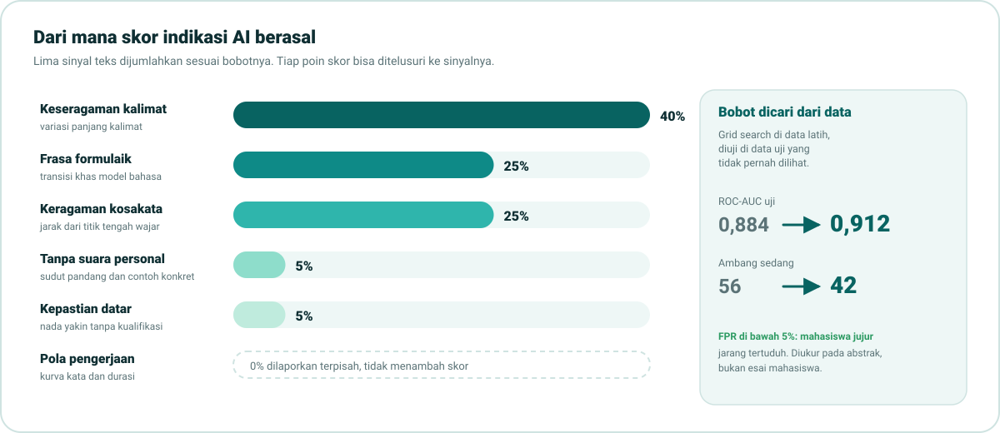
</p>

<details>
<summary><b>Apa arti lima sinyal itu?</b></summary>

| Sinyal | Yang diukur |
|---|---|
| Keseragaman kalimat | Teks AI cenderung punya panjang kalimat yang mirip-mirip. Tulisan manusia lebih bervariasi. |
| Frasa formulaik | Kepadatan transisi khas model bahasa ("selain itu", "oleh karena itu", "dengan demikian"). |
| Keragaman kosakata | Rasio kata unik. Dinetralkan di bawah 120 kata karena teks pendek selalu tampak beragam. |
| Tanpa suara personal | Tidak ada sudut pandang pribadi atau contoh konkret. |
| Kepastian datar | Semua kalimat yakin, tanpa keraguan atau kualifikasi yang wajar. |

Bobotnya **dicari dari data**, bukan ditebak: grid search di data latih, diuji di data uji yang tidak pernah dilihat. Ambang sedang turun dari 56 ke **42**.

</details>

### 3. Level berpikir: Bloom L1 sampai L6

Taksonomi Bloom membagi penalaran jadi enam tingkat. Dosen memilih **target level** tiap tugas. ThinkPath menaksir **level yang benar-benar muncul** di jawaban, lengkap dengan tingkat keyakinan dan kutipan bukti. Estimator: Groq, dengan heuristik lokal sebagai cadangan.

<p align="center">
  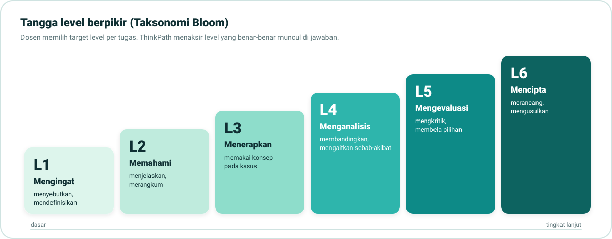
</p>

| Level | Nama | Jawaban yang menunjukkannya | Contoh kata kerja |
|---|---|---|---|
| **L1** | Mengingat | Menyebut fakta | menyebutkan, mendefinisikan, mendaftar |
| **L2** | Memahami | Menjelaskan dengan kata sendiri | menjelaskan, merangkum, memberi contoh |
| **L3** | Menerapkan | Memakai konsep pada kasus | menerapkan, menghitung, mengerjakan |
| **L4** | Menganalisis | Menguraikan dan membandingkan | menganalisis, membedakan, mengaitkan sebab-akibat |
| **L5** | Mengevaluasi | Menilai dengan alasan | mengevaluasi, mengkritik, membela pilihan |
| **L6** | Mencipta | Menghasilkan sesuatu yang baru | merancang, menyusun, mengusulkan |

Hasilnya dipakai dua cara. Di sisi dosen: peta kelas yang memisahkan **"perlu bantuan"** (level di bawah target) dari **"perlu ditanya"** (indikasi AI tinggi). Di sisi mahasiswa: grafik perkembangan level penalaran lintas tugas.

### 4. Bukti pendukung

Tiga bukti tambahan membantu dosen menimbang. **Ketiganya tidak menambah skor AI.**

| Bukti | Isi |
|---|---|
| **Pola pengerjaan** | Kurva pertumbuhan kata, durasi, revisi. Dilaporkan terpisah dari skor. |
| **Penanda gaya teks** | Sisa salinan dari obrolan: simbol poin `•`, sintaks markdown, kalimat penutup seperti "beri tahu saya", emoji, karakter tak terlihat. Disorot langsung di teks, bersama ritme panjang kalimat. |
| **Kemiripan antar jawaban** | Potongan 5 kata berurutan yang sama persis dengan jawaban lain di tugas yang sama. Persentase terlihat, dan dosen bisa membuka dua jawaban **berdampingan**. |

Jawaban dari dokumen juga bisa diperiksa: dokumen asli dibuka dosen, teks hasil bacanya (OCR) digabung dengan tulisan mahasiswa di kotak jawaban, lalu dianalisis bersama.

### 5. Cek Paham: tes lisan singkat

Skor dan sinyal hanya menghasilkan dugaan. **Cek Paham** memberi mahasiswa kesempatan menjelaskan jawabannya sendiri.

<p align="center">
  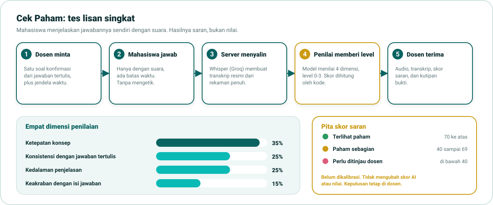
</p>

- Dosen mengajukan **satu soal** yang merujuk bagian tertentu dari jawaban tertulis, plus jendela waktu.
- Mahasiswa menjawab **hanya dengan suara**. Rekaman utuh ditranskrip server (Whisper lewat Groq). Caption langsung hanya pembanding.
- Penilai (model bahasa) memberi **level 0 sampai 3** pada empat dimensi. **Skor dihitung oleh kode**, bukan ditulis model.
- Mahasiswa bisa **melaporkan kendala** (transkrip salah, mikrofon bermasalah). Dosen dapat mengizinkan mengulang.
- Audio dihapus otomatis setelah **30 hari**. Transkrip dan hasil tetap tersimpan.

> **Penting.** Skor Cek Paham adalah **saran, belum dikalibrasi**. Ia tidak mengisi nilai dan tidak mengubah skor AI. Sengaja dipisah supaya skor yang keliru tidak bisa membenarkan dirinya sendiri.

### 6. Fitur lain

| Untuk dosen | Untuk mahasiswa |
|---|---|
| Kelas dengan kode gabung | Beranda: tugas, tenggat, nilai terbaru |
| Tugas dengan instruksi kaya (gambar, tautan) dan target level Bloom | Editor kaya: tabel, rumus, kode, tautan, gambar kecil |
| Antrean **Periksa** per tugas, saring dan cari | Unggah dokumen (PDF, Word, foto) lalu dibaca otomatis |
| **Saran satu klik** dari bukti yang ada | Simpan otomatis dan boleh revisi sebelum tenggat |
| **Analitik** per kelas dan lintas kelas | **Jadwal** bentuk kalender, **Gradebook**, to-do pribadi |
| Materi per topik, forum kelas, notifikasi | Materi, forum kelas, notifikasi |
| Profil kognitif tiap mahasiswa | Melihat perkembangan level penalaran sendiri |

**Privasi dibuat serius.** Persetujuan satu centang saat daftar, sesuai UU No. 27 Tahun 2022 (UU PDP), dengan bukti persetujuan per versi dan hak menarik persetujuan kapan saja. Layanan luar negeri (Groq, Winston) hanya menerima teks tanpa nama atau email. Mahasiswa bisa menghapus akun beserta datanya sendiri. Detail: [Kebijakan Privasi](https://thinkpath.vercel.app/kebijakan-privasi) dan [diagram/07-privasi-dan-persetujuan.md](./diagram/07-privasi-dan-persetujuan.md).

### Seberapa akurat?

Jujur apa adanya:

| Aspek | Status |
|---|---|
| Bobot sinyal teks dan ambang sedang 42 | **Terukur.** ROC-AUC uji 0,884 naik ke 0,912 pada gold set 999 sampel. FPR di bawah 5%. |
| Ambang tinggi 70, lapisan Winston dan Groq | Belum terukur pada teks Indonesia. |
| Level Bloom | Berjalan, **belum divalidasi penilai manusia**. |
| Cek Paham | Berjalan. Rubrik dan ambang **belum dikalibrasi**, UI selalu memberi label itu. |
| Uji otomatis | 547 tes backend dan 85 tes ai_experiment, semuanya lolos. |

> Gold set berisi **abstrak akademik**, bukan esai mahasiswa. Angka sah untuk membandingkan sinyal, tapi **bukan klaim akurasi pada jawaban tugas**. Seluruh eksperimen ada di [`ai_experiment/notebooks`](./ai_experiment/notebooks), disajikan bertahap dari gold set sampai evaluasi.

---

## Tech Stack dan Arsitektur

<p align="center">
  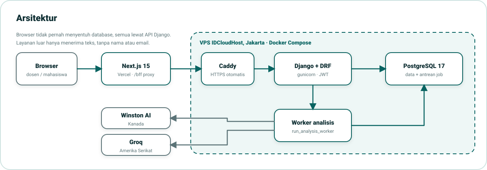
</p>

| Layer | Teknologi | Tempat |
|---|---|---|
| Frontend | Next.js 15 (App Router), React 19, TypeScript, Tailwind 3, shadcn/ui, Recharts, TipTap | Vercel |
| Backend | Django 5.2 LTS, Django REST Framework, JWT, gunicorn | VPS IDCloudHost, Jakarta |
| Database | PostgreSQL 17 (antrean job analisis juga di sini, tanpa Redis) | Container yang sama |
| Server | Docker Compose, Caddy (HTTPS otomatis) | VPS yang sama |
| Analisis | Winston AI, Groq `openai/gpt-oss-120b`, heuristik lokal, Whisper (suara) | API luar dan server sendiri |
| Dokumen | PyMuPDF, pembaca DOCX, OCR gambar lewat model visual Groq | Server sendiri |

**Prinsip arsitektur:**

- Frontend **tidak pernah menyentuh database**. Semua lewat API Django.
- Token login disimpan di cookie **HttpOnly**, dan browser bicara lewat proxy `/bff`.
- Analisis berjalan di **worker terpisah**. Mengumpulkan jawaban selalu cepat, dan layar mahasiswa menunggu hasil lewat polling.
- Skor AI **tidak pernah dikirim** ke layar mahasiswa.

---

## Struktur Project

```
thinkpath/
├── frontend/          Next.js 15: antarmuka dosen dan mahasiswa
│   ├── app/             Rute tipis (dashboard/ untuk dosen, student/ untuk mahasiswa)
│   ├── components/      ui/ shared/ layout/ charts/ (tanpa urusan domain)
│   ├── features/        Satu folder per domain: submissions, assignments, cekpaham, bloom, ...
│   └── lib/ hooks/      Klien API, tipe, hook bersama
├── backend/           Django 5 + DRF, satu-satunya API untuk semua data
│   └── apps/
│       ├── accounts/      Akun, JWT, persetujuan privasi
│       ├── academics/     Kelas, tugas, jawaban, dokumen, saran
│       ├── analysis/      Mesin E1 (indikasi AI) dan E2 (Bloom), pipeline
│       ├── cekpaham/      Tes lisan: transkrip, penilai, rubrik
│       └── forum/ todos/ notifications/
├── ai_experiment/     Validasi dan kalibrasi, disajikan sebagai notebook bertahap
├── diagram/           Diagram arsitektur, alur peran, design system, ERD (Mermaid)
└── assets/            Gambar dan SVG untuk README ini
```

Dokumentasi per bagian: [backend/README.md](./backend/README.md) (endpoint, env, deploy), [frontend/README.md](./frontend/README.md) (rute, aturan impor, design system), [ai_experiment/README.md](./ai_experiment/README.md) (eksperimen).

---

## Menjalankan di Lokal

Jalan di **macOS, Linux, dan Windows**. Butuh tiga hal terpasang: **Python 3.12+**, **Node.js 20+**, dan **PostgreSQL 15+** yang menyala.

**0. Siapkan database (sekali saja)**

| Sistem | Perintah |
|---|---|
| macOS | `brew install postgresql@18 && brew services start postgresql@18 && createdb thinkpath` |
| Linux (Debian/Ubuntu) | `sudo apt install postgresql && sudo -u postgres createdb thinkpath` |
| Windows | Pasang [PostgreSQL](https://www.postgresql.org/download/windows/), lalu buat database `thinkpath` lewat pgAdmin |

**1. Backend** (terminal 1, jalan di http://127.0.0.1:7860)

```bash
cd backend
python3 -m venv venv
source venv/bin/activate          # Windows: venv\Scripts\activate
pip install -r requirements.txt
cp .env.example .env              # Windows: copy .env.example .env
python manage.py migrate
python manage.py seed_demo_data   # akun dan data demo
python manage.py runserver 127.0.0.1:7860
```

Windows atau password Postgres berbeda: isi `POSTGRES_USER` dan `POSTGRES_PASSWORD` di `backend/.env`. Kunci `GROQ_API_KEY` dan `WINSTON_API_KEY` boleh kosong. Analisis otomatis memakai heuristik lokal.

**2. Frontend** (terminal 2, jalan di http://localhost:3000)

```bash
cd frontend
cp .env.local.example .env.local  # Windows: copy .env.local.example .env.local
npm install
npm run dev
```

Buka http://localhost:3000 lalu masuk dengan akun demo (`dosen@thinkpath.local`, password `thinkpath123`).

**Tes dan eksperimen**

```bash
cd backend && python manage.py test        # tes backend (SQLite in-memory, aman)
cd frontend && npx tsc --noEmit && npm run lint
cd ai_experiment && pip install -r requirements.txt && jupyter lab notebooks
```

Backend juga bisa dijalankan dengan Docker, dan panduan deploy VPS ada di [backend/README.md](./backend/README.md).

---

## Tim

**DataDigger**, Universitas Bina Nusantara.

| Nama | NIM | GitHub |
|---|---|---|
| Fadhlan Nur Rachman | 2802491690 | [@FadhRach](https://github.com/FadhRach) |
| Bambang Aranaya Saputra | 2802388831 | [@Bambang-Saputra](https://github.com/Bambang-Saputra) |
| Pasya Kemal Halim | 2802486684 | [@Pasya-Kemal](https://github.com/Pasya-Kemal) |

---

## Link Terkait

| Tipe | Link |
|---|---|
| Aplikasi (live) | https://thinkpath.vercel.app |
| Kebijakan Privasi | https://thinkpath.vercel.app/kebijakan-privasi |
| Repository | https://github.com/FadhRach/ThinkPath |
| Laporan akhir | _segera_ |
| Makalah | _segera_ |
| Video profil | _segera_ |
| Video karya | _segera_ |
| HKI | _segera_ |
| Diagram sistem (Mermaid) | [`diagram/`](./diagram) |
| Eksperimen dan validasi | [`ai_experiment/notebooks`](./ai_experiment/notebooks) |

---

<p align="center"><sub>ThinkPath · DataDigger · Universitas Bina Nusantara · GEMASTIK XIX 2026</sub></p>
