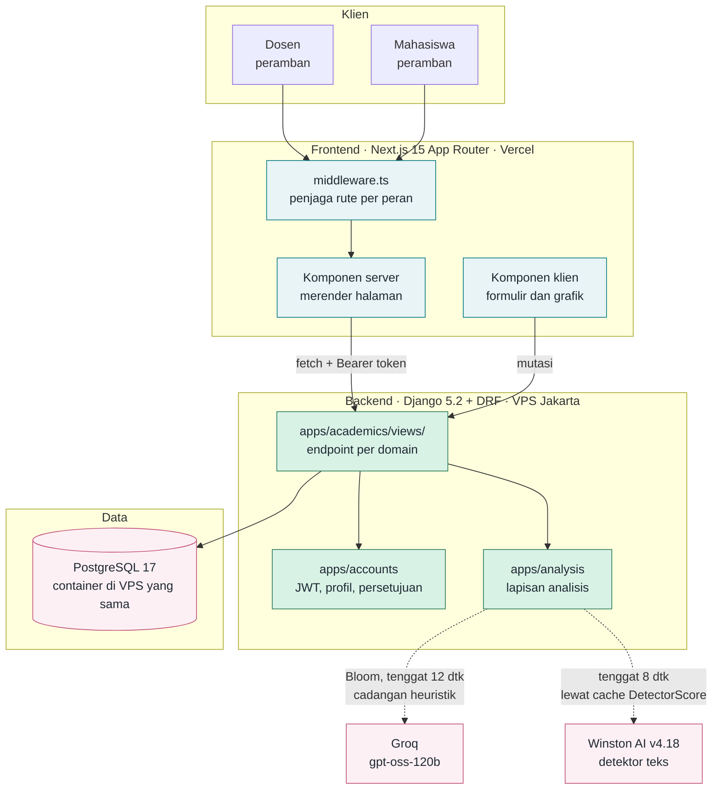
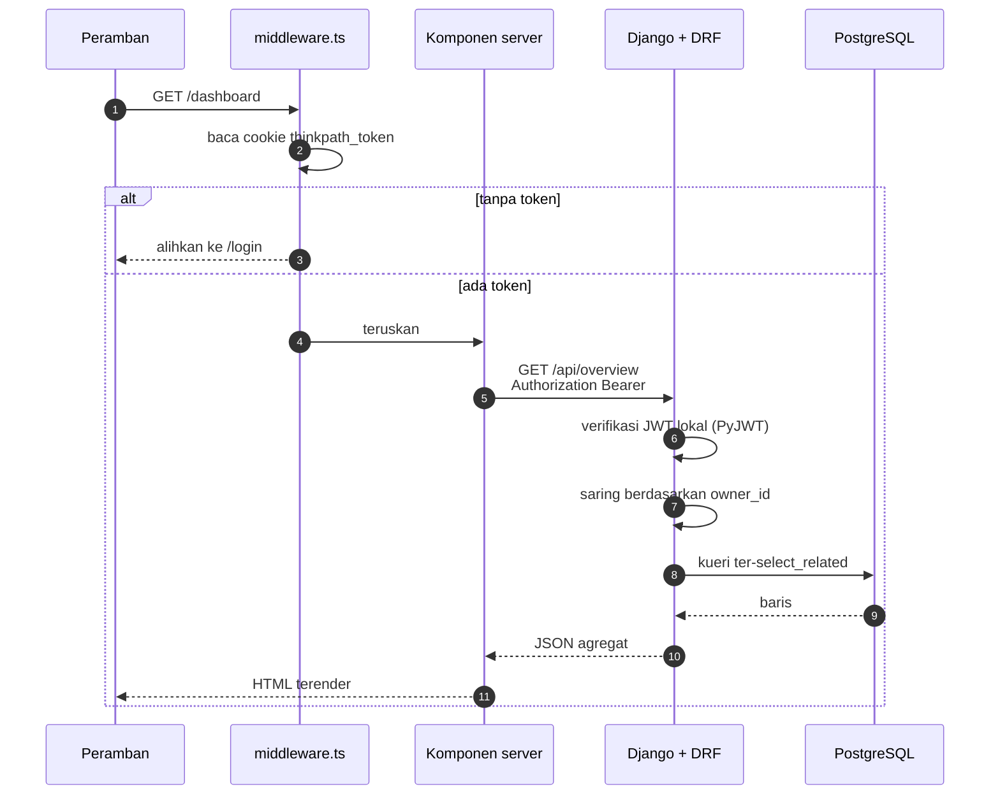
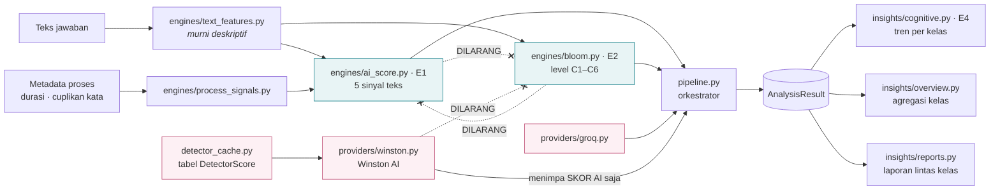
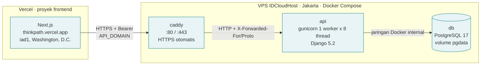

# 01 · Arsitektur Sistem

Diagram di berkas ini menggambarkan susunan sistem, bukan alur pemakaian. Untuk
alur per peran lihat [02](./02-alur-dosen.md), [03](./03-alur-mahasiswa.md), dan
[04](./04-interaksi-gabungan.md).

---

## 1.1 Peta lapisan

Pola yang dipakai adalah **satu pintu API**. Frontend tidak pernah menyentuh
basis data secara langsung; seluruh kueri, autentikasi, dan logika bisnis
terpusat di Django.

**Kenapa satu pintu.** Kepemilikan data dan izin akses hanya perlu dijaga di
satu tempat. Setiap endpoint menyaring berdasarkan pemilik lewat helper
`require_owned_*` di `apps/academics/selectors.py`, dan tidak ada jalur kedua
yang bisa melewatinya.

---

## 1.2 Perjalanan satu permintaan

Verifikasi token terjadi **di proses yang sama**, tanpa panggilan ke layanan
pihak ketiga. Dua layanan luar yang dipakai, Groq dan Winston, keduanya hanya
disentuh saat menganalisis tugas, dan keduanya punya jalur cadangan. Tidak ada
satu pun permintaan halaman yang bergantung pada layanan luar.

Keduanya dipanggil **berurutan**, bukan bersamaan: 12 detik untuk Groq lalu 8
detik untuk Winston, sehingga kasus terburuknya 20 detik. Panggilan itu tidak
terjadi di dalam request: submit hanya menyimpan jawaban dan satu job di tabel
`analysis_jobs`, lalu container `worker` (`manage.py run_analysis_worker`)
mengerjakannya. gunicorn (1 worker, 8 thread) tidak pernah menunggu Groq atau
Winston untuk analisis jawaban, jadi dashboard dosen tidak ikut membeku.

---

## 1.3 Lapisan analisis

Tiga panah putus-putus itu **dijaga uji otomatis** yang membaca kode lewat AST,
bukan pencocokan teks. Menambahkan `import` terlarang akan langsung
menggagalkan tes, sehingga pemisahan ini tidak bisa runtuh tanpa disadari.

Alasannya: level kognitif dan dugaan penggunaan AI adalah dua hal berbeda.
Mahasiswa bisa menulis analisis tajam dengan bantuan AI, dan bisa juga menulis
jawaban lemah sepenuhnya sendiri.

Detektor eksternal masuk sebagai **penimpa di atas hasil yang sudah jadi**, bukan
cabang di tengah alur. Karena skor Bloom sudah selesai dihitung sebelum detektor
dipanggil, tidak ada jalur kode yang bisa membawa skor detektor ke sana. Bentuk
itu membuat pemisahannya berdiri sendiri, bukan bergantung pada kedisiplinan
siapa pun yang menyunting berkas ini nanti.

---

## 1.4 Susunan penempatan

Frontend tetap di Vercel; backend dan basis data satu mesin di VPS. Postgres
tidak membuka port ke internet, dan port API hanya terikat ke `127.0.0.1`
(untuk debug lewat SSH tunnel). Satu-satunya pintu publik adalah Caddy, yang
juga mengurus sertifikat Let's Encrypt dan pengalihan HTTP ke HTTPS.

**Migrasi berjalan otomatis** setiap container `api` mulai
(`deploy/entrypoint.sh`), jadi `make deploy` di VPS sudah mencakup migrasi.
Runbook lengkap ada di [backend/README.md](../backend/README.md).

**Jebakan saat menempatkan.** Backend butuh URL frontend untuk
`CORS_ALLOWED_ORIGINS`, sedangkan frontend butuh URL backend untuk
`NEXT_PUBLIC_BACKEND_URL`. Karena domain API sudah diketahui sebelum deploy,
isi keduanya sekaligus; kalau CORS lupa diisi, gejalanya halaman termuat tetapi
semua data kosong.

**Di belakang proxy.** Django membaca `X-Forwarded-Proto` untuk tahu permintaan
asli HTTPS, dan DRF membaca `X-Forwarded-For` (`NUM_PROXIES=1`) untuk throttle
login per IP. Tanpa yang kedua, semua pengguna terhitung satu IP, yaitu IP
container Caddy.
