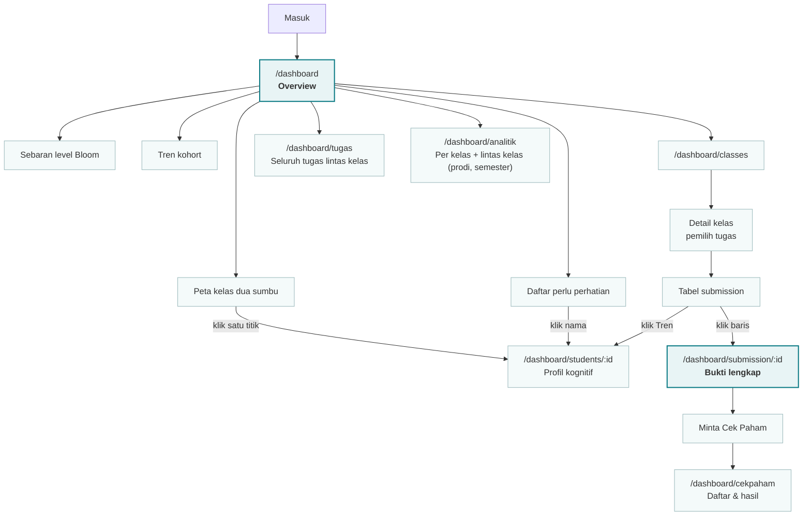
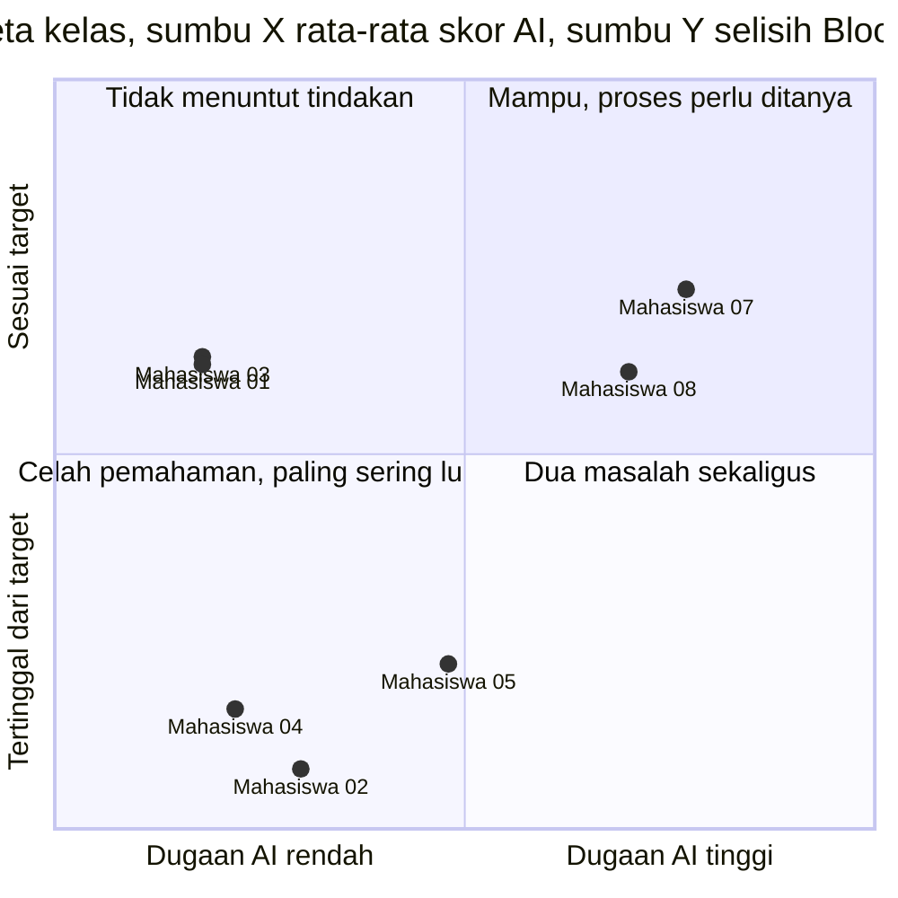
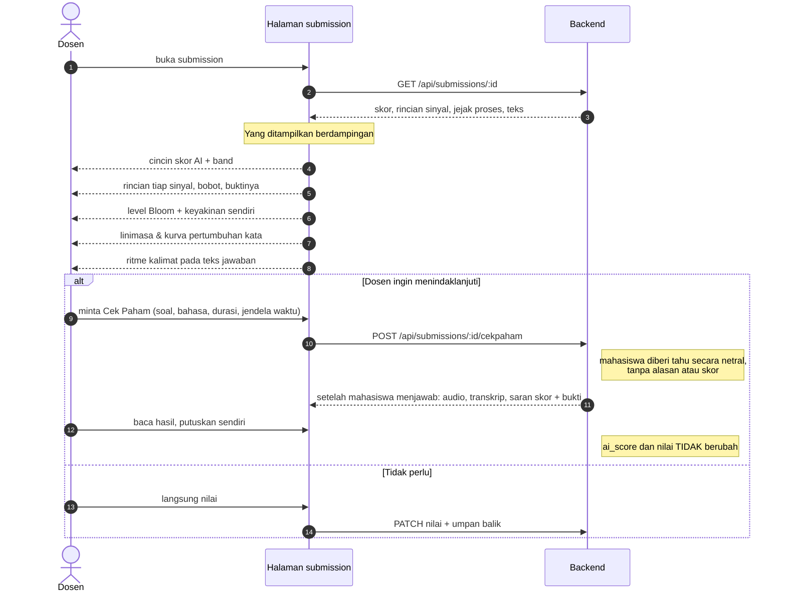
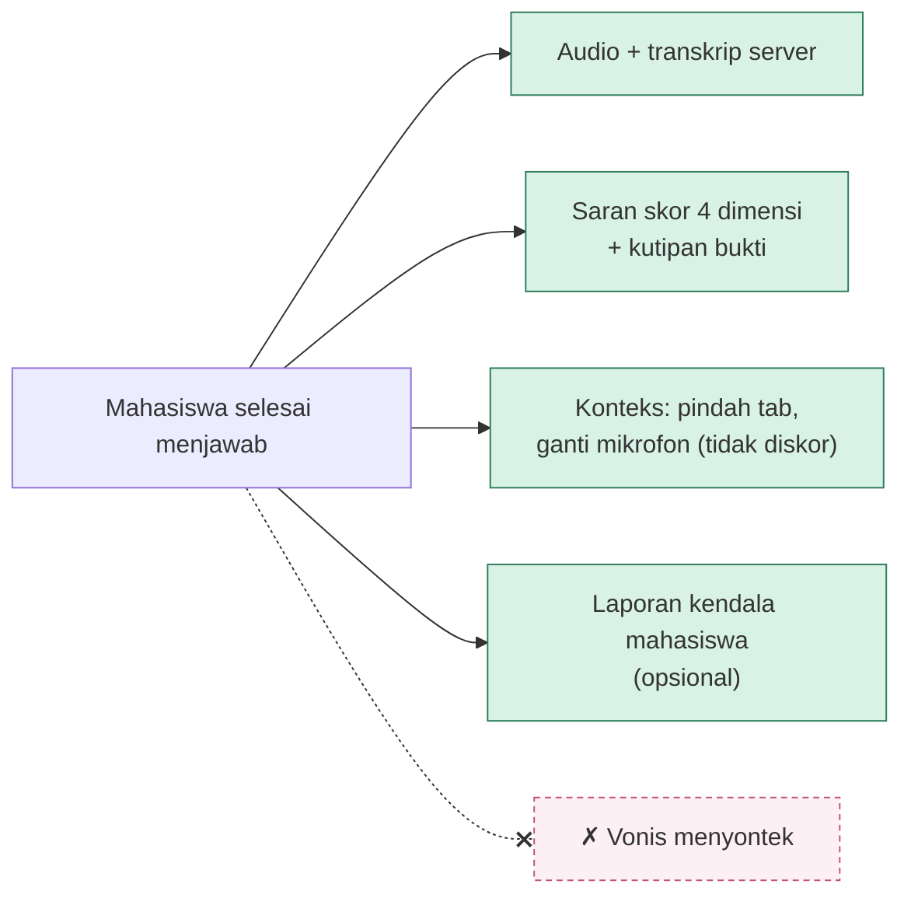
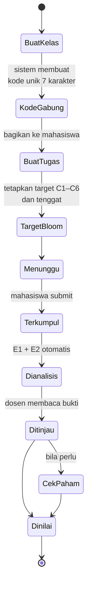

# 02 · Interaksi Sistem dengan Dosen

Seluruh alur di sini bertumpu pada satu prinsip: sistem menyodorkan **bukti**,
keputusan tetap di tangan dosen.

---

## 2.1 Peta perjalanan dosen

---

## 2.2 Membaca peta kelas

Peta memakai **dua sumbu, bukan peringkat**. Peringkat satu sumbu memaksa dosen
membaca kelasnya sebagai antrean tersangka, dan menyembunyikan kuadran yang
paling sering luput.

**Kuadran kiri bawah adalah alasan peta ini ada.** Mahasiswa dengan skor AI
rendah yang tertinggal jauh dari target: jujur, dan tidak tertolong. Alat yang
hanya memberi satu skor kecurigaan tidak akan pernah menunjukkannya.

Pada data demo, himpunan "perlu bantuan" dan himpunan "dicurigai" memang tidak
beririsan sama sekali.

---

## 2.3 Alur meninjau satu submission

**Penjagaan yang disengaja.** Hasil Cek Paham **tidak pernah** menulis balik
ke `ai_score`, level Bloom, atau nilai: skor yang keliru tidak boleh
membenarkan dirinya sendiri lewat tes yang ia picu sendiri. Skor Cek Paham
sendiri hanya saran dan belum dikalibrasi, sehingga selalu berlabel demikian.

---

## 2.4 Yang dosen terima dari Cek Paham

Sistem tidak menyediakan vonis. Skor hanya saran, kutipan buktinya diperiksa
harus benar-benar ada di transkrip, dan mahasiswa yang merasa transkripnya
keliru dapat melapor sehingga dosen bisa mengizinkan percobaan ulang.

---

## 2.5 Membuat kelas dan tugas

Jenjang, program studi, dan semester melekat pada **kelas**, bukan pada tugas
maupun profil. Tugas mewarisinya dari kelas tempat ia dibuat, sehingga tidak
mungkin ada tugas S2 tersimpan di dalam kelas S1.
