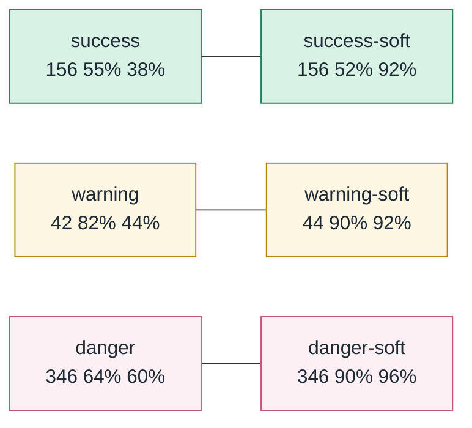
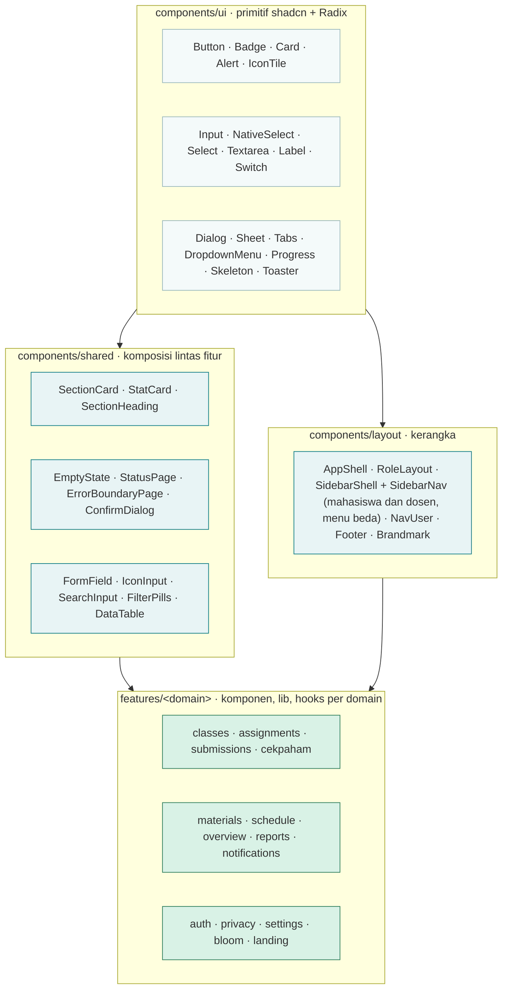
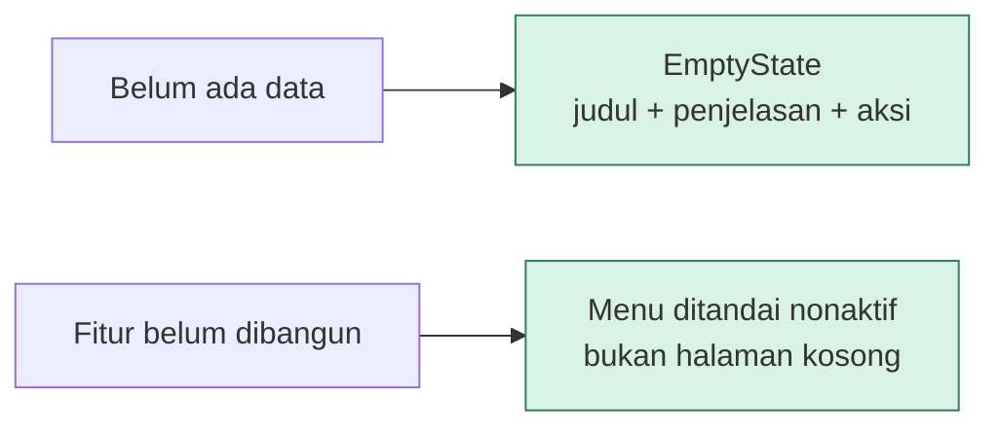
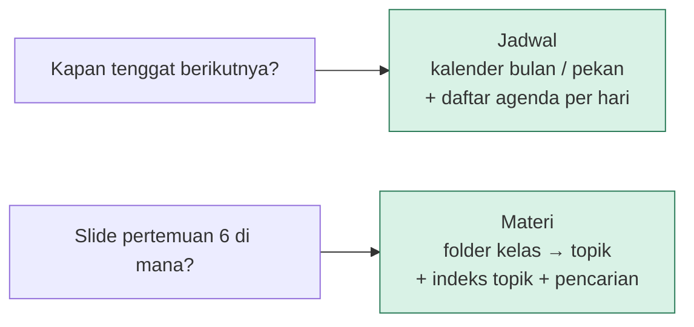

# 06 · Design System

Seluruh token di berkas ini diambil dari `frontend/styles/tokens.css` dan
`frontend/tailwind.config.ts`. Bila keduanya berubah, berkas ini harus menyusul.
Aturan lapisan komponen dan cara menambah komponen ada di `frontend/README.md`.

---

## 6.1 Palet warna

Warna disimpan sebagai variabel CSS bernilai HSL tanpa pembungkus, sehingga
Tailwind bisa menambahkan alpha sendiri lewat `hsl(var(--token) / 0.5)`.

### Token merek

| Token | HSL | Peran |
|---|---|---|
| `--brand-teal` | `178 90% 38%` | Dekorasi dan garis grafik (terlalu terang untuk teks putih) |
| `--brand-teal-light` | `173 68% 61%` | Gradasi dan aksen kedua |
| `--brand-mint` | `161 66% 81%` | Latar sekunder, sorotan lembut |
| `--brand-pink` | `340 100% 96%` | Latar avatar |

### Token semantik

| Token | HSL | Peran |
|---|---|---|
| `--background` | `164 36% 96%` | Latar halaman |
| `--foreground` | `176 51% 12%` | Teks utama |
| `--card` | `0 0% 100%` | Permukaan kartu |
| `--primary` / `--primary-foreground` | `178 86% 21%` / putih | Tombol utama (kontras ±7:1) |
| `--brand-ink` | `178 86% 21%` | Teks aksen dan tautan (`text-brand-ink`) |
| `--secondary` | `161 66% 81%` | Lencana, sorotan |
| `--muted` | `164 40% 94%` | Latar tenang |
| `--muted-foreground` | `169 11% 40%` | Teks penjelas |
| `--border` / `--input` | `160 27% 89%` | Garis pemisah dan tepi isian |
| `--ring` | `178 90% 38%` | Cincin fokus |

Token gelap ditulis sebagai `[data-theme="dark"]` di `styles/tokens.css` dan baru
aktif di landing (mengikuti sistem, atau `?tema=gelap|terang`). Aplikasi belum
mengaktifkannya: tema yang tersimpan butuh cookie atau localStorage, yang
bertentangan dengan kebijakan privasi (satu cookie, tanpa penyimpanan peramban).

### Token status

**Aturan pemakaian warna status.** Warna menandai **tindakan yang perlu diambil**,
bukan tingkat kecurigaan. Selisih Bloom yang tertinggal memakai `warning` karena
ia temuan terukur; skor AI tinggi memakai `danger` hanya ketika bergabung dengan
ketertinggalan, karena sendirian ia masih dugaan.

---

## 6.2 Skala tipografi

Seluruh antarmuka memakai satu keluarga huruf, **Plus Jakarta Sans**, dimuat
self-hosted lewat `next/font` di `app/layout.tsx`. Tidak ada serif atau
monospace; hierarki dibangun dari ukuran dan bobot, bukan dari ganti huruf.

| Kelas | Ukuran | Tinggi baris | Pemakaian |
|---|---|---|---|
| `text-title` | 1.6 sampai 2.1rem (fluid) | 1.15 | Judul halaman |
| `text-display-2` | 1.875rem | 1.2 | Judul besar |
| `text-heading` | 1.25rem | 1.3 | Judul bagian dan kartu |
| `text-body-lg` | 1.0625rem | 1.65 | Paragraf penting |
| `text-body` | 0.9375rem | 1.6 | Teks umum |
| `text-body-sm` | 0.8125rem | 1.55 | Penjelasan, isi tabel |
| `text-caption` | 0.75rem | 1.4 | Keterangan, satuan |
| `text-micro` | 0.6875rem | 1.35 | Lencana kecil |

Kelas tambahan `caption-eyebrow` dipakai sebagai label kecil di atas judul
kartu, selalu berpasangan dengan `text-brand-ink`. Ukuran arbitrer seperti
`text-[0.65rem]` tidak dipakai lagi.

---

## 6.3 Bentuk dan kedalaman

| Token | Nilai | Pemakaian |
|---|---|---|
| `--radius` | `0.75rem` | Dasar; `rounded-lg`, `md`, `sm` diturunkan darinya |
| `rounded-xl` | `0.75rem` | Kartu dan kontrol; satu-satunya radius kartu |
| `shadow-soft` | dua lapis, opasitas rendah | Kartu diam |
| `shadow-soft-lg` | lebih menyebar | Kartu saat disentuh kursor |

Bayangan sengaja sangat lembut. Antarmuka ini menampilkan bukti yang menyangkut
nama orang, dan bayangan tebal membuat setiap kartu terasa seperti peringatan.

---

## 6.4 Hierarki komponen

Aturan arah impor dijaga ESLint (`.eslintrc.json`): `ui` tidak mengimpor
`shared`, `layout`, atau `features`; `shared` dan `charts` tidak mengimpor
`features` atau `layout`; kode di luar `app/` tidak mengimpor dari `app/`.
Komponen fitur tidak memanggil primitif Radix langsung untuk hal yang sudah
punya pembungkus bersama, supaya perubahan gaya cukup dilakukan di satu tempat.

Umpan balik kepada pengguna punya tiga jalur tetap: **toast** (`lib/notify.ts`)
untuk hasil aksi, **`Alert`** untuk pesan yang harus tetap terlihat di halaman,
dan **`ConfirmDialog`** sebelum aksi berisiko. Halaman 404, 403, dan galat memakai
satu `StatusPage`.

---

## 6.5 Pola visualisasi data

| Grafik | Bentuk | Dipakai di | Yang diwarnai |
|---|---|---|---|
| `AiBloomScatter` | Scatter empat kuadran | Overview | Tindakan yang perlu diambil |
| `BloomDistributionChart` | Histogram + garis target | Overview | Gradasi teal; di bawah target jadi `warning` |
| `CohortTrendChart` | Area + garis target berundak | Overview | Teal untuk kelas, `warning` untuk target |
| `BloomTrendChart` | Area + garis acuan | Profil kognitif, progres | Teal, gradasi id unik per instans |
| `AiScoreRing` | Cincin SVG | Detail submission | Mengikuti band |
| Kurva pertumbuhan | Area SVG polos | Linimasa submission | Teal |
| Bilah ritme kalimat | Batang per kalimat | Teks jawaban | Teal seragam |

**Tiga aturan grafik yang tidak boleh dilanggar.**

Pertama, **id gradien SVG wajib unik per instans**. Satu halaman bisa memuat
beberapa grafik sejenis, dan id yang dipatok tetap membuat semuanya merujuk
gradien pertama. Ini pernah terjadi dan diperbaiki dengan `useId()`.

Kedua, **grafik lebar wajib bisa digulir di dalam wadahnya sendiri**. Badan
halaman tidak boleh ikut bergulir mendatar.

Ketiga, **warna tidak boleh menyiratkan klaim yang tidak dimiliki data**. Ritme
kalimat mewarnai panjang kalimat, bukan tingkat kecurigaan, karena tidak ada
satu kalimat pun yang terdeteksi AI.

---

## 6.6 Pola keadaan kosong dan menu nonaktif

Menu **Materi** dan **Jadwal** dulu dibiarkan nonaktif sampai model backend-nya
ada, dan kini sudah aktif. Yang masih nonaktif adalah kolom pencarian global di
header: belum ada endpoint pencariannya, jadi input-nya dimatikan, bukan
dibiarkan menerima ketikan lalu tidak melakukan apa pun. Menu atau input yang
bisa dipakai tetapi tidak melakukan apa pun lebih menyesatkan daripada yang
jujur menyatakan dirinya belum jadi.

Prinsip yang sama pernah berlaku pada lonceng notifikasi: titik merahnya dihapus
selama tombolnya belum punya penangan. Lonceng sekarang aktif, dan lencananya
menghitung notifikasi yang benar-benar belum dibaca.

---

## 6.7 Bahasa antarmuka

| Konteks | Sapaan | Contoh |
|---|---|---|
| Layar dosen | formal, "Anda" | "Kelas yang Anda ampu" |
| Layar mahasiswa | akrab, "kamu" | "Perkembangan cara berpikirmu" |
| Keterangan batas | terus terang | "Bahan tinjau, bukan vonis" |

Komponen yang dipakai kedua peran, misalnya `ProfileSettings`, memilih sapaan
berdasarkan `profile.role`, bukan menduplikasi berkasnya.

**Setiap layar yang menampilkan dugaan wajib menyertakan batasnya.** Contoh yang
sudah terpasang: halaman laporan memuat kartu bertuliskan "Belum tervalidasi",
dan halaman Cek Paham menjelaskan bahwa skornya saran yang belum dikalibrasi.

---

## 6.8 Zona waktu tampilan

Seluruh waktu ditampilkan dalam satu zona tetap, bawaannya `Asia/Jakarta`, dan
dapat diganti lewat `NEXT_PUBLIC_DISPLAY_TIME_ZONE`.

Zona dipaku, bukan mengikuti peramban, supaya dosen dan mahasiswa membaca jam
yang **sama persis** ketika membicarakan satu submission. Membiarkannya mengikuti
mesin yang merender pernah membuat jam meleset tujuh jam di Vercel, dan untuk
produk ini akibatnya bukan kosmetik: pengumpulan pukul 02.37 akan tampil 19.37
dan terlihat wajar.

Kalender Jadwal mengikuti aturan yang sama. Hari dihitung sebagai kunci
`YYYY-MM-DD` pada zona tampilan, lalu batas rentangnya dikirim ke backend
sebagai waktu UTC, sehingga tenggat pukul 23.59 WIB tidak pernah bergeser ke
kotak hari berikutnya.

---

## 6.9 Materi dan Jadwal: dua cara mencari

Mahasiswa mencari jadwal lewat **tanggal** dan mencari materi lewat **kelas dan
pertemuannya**. Karena itu keduanya sengaja tidak berbentuk sama.

| | Jadwal | Materi |
|---|---|---|
| Rujukan pola | Google Calendar, kalender Google Classroom | "Tugas Kelas" Google Classroom, daftar sesi LMS kampus |
| Susunan | Kotak tanggal; di ponsel titik penanda + daftar agenda | Folder per kelas, lalu kelompok per topik atau pertemuan |
| Navigasi | Hari ini, mundur-maju, bulan/pekan, saringan kelas | Indeks topik menempel di samping; di ponsel chip menempel di atas |
| Alamat | `/student/jadwal?tampilan=minggu&tanggal=…&kelas=…` | `/student/kelas/<kelas>?tab=materi#topik-…` atau `#materi-…` |
| Warna | Status agenda: kuning belum dikerjakan, hijau dinilai, abu terlewat, sesi sebagai kartu teal | Jenis sumber: slide, dokumen, video, bacaan web, catatan dosen |

Tenggat yang terlewat berwarna abu, bukan merah. Pengumpulan sudah ditutup,
jadi tidak ada lagi yang bisa dilakukan mahasiswa; warna mendesak disisakan
untuk tenggat yang masih bisa dikerjakan.
