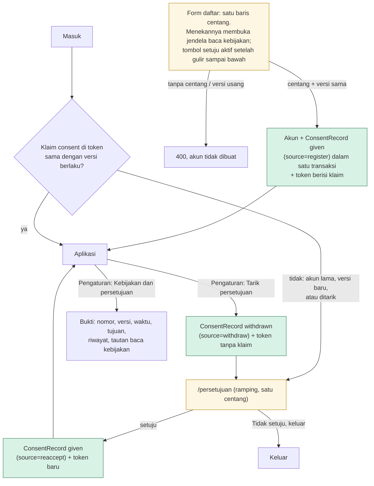
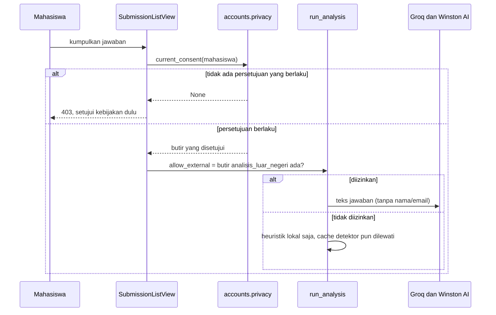

# 07 · Privasi dan Persetujuan

Berkas ini adalah jejak pertanggungjawaban halaman `/kebijakan-privasi`. Setiap
pernyataan di halaman itu dipetakan ke kode yang melaksanakannya dan ke pasal
yang mendasarinya, supaya isinya bisa diperiksa, bukan sekadar dipercaya.

Sumber hukum dibaca langsung dari teks resmi UU No. 27 Tahun 2022 tentang
Pelindungan Data Pribadi (UU PDP) di JDIH BPK, bukan dari ringkasan pihak ketiga.
Fakta penyedia layanan diambil dari dokumen resmi masing-masing penyedia, yang
dicantumkan di bagian 7.7.

Versi kebijakan yang dibahas: **2026-10-23** (penghapusan akun mandiri, kelas dosen menjadi arsip, atur ulang sandi lewat email, skor AI dari teks saja dan pola pengerjaan terpisah, cookie HttpOnly).

---

## 7.1 Alur persetujuan

Persetujuan diberikan **satu kali, dengan satu centang di form daftar**. Tiap
tujuan tetap ditulis terpisah di atas centang dan dicatat sebagai butir
tersendiri; butirnya ditentukan server dari peran, bukan dikirim klien.

Isi jendela baca adalah komponen `PolicyArticle` yang sama dengan halaman
`/kebijakan-privasi`, jadi yang dibaca sebelum menyetujui selalu identik dengan
dokumen yang tayang. Kotak centang tidak bisa dicentang langsung; hanya tombol
"Saya menyetujui" di dasar jendela yang mencentangnya.

Tidak ada persetujuan per fitur: rekaman suara Cek Paham dan pengiriman ke
penyedia di luar negeri adalah butir dalam persetujuan yang sama (versi
2026-10-17 dan sebelumnya masih memisahkannya sebagai pilihan opsional).

Gerbang di layout membaca klaim `consent` dari token tanpa panggilan jaringan,
sama seperti klaim peran, supaya halaman tetap tampil seketika. Gerbang itu
hanya untuk tampilan. Pemrosesan data baru selalu diperiksa ke basis data
(bagian 7.2), karena token lama di perangkat lain masih memuat klaim
persetujuan setelah mahasiswa menariknya.

Halaman `/kebijakan-privasi` selalu terbuka tanpa login. Bagi pembaca yang
login, pita di atasnya menampilkan versi dan waktu persetujuannya.

---

## 7.2 Penegakan di server

Analisis Ulang milik dosen melewati pemeriksaan yang sama terhadap persetujuan
mahasiswa pemilik jawaban. Persetujuan yang dibuat lewat UI selalu memuat butir
analisis luar negeri; pengecekan butir itu tetap dipertahankan sebagai pengaman
(catatan tanpa butir itu memaksa jalur heuristik). Gerbang Cek Paham
(`cekpaham/services/gate.py`) memeriksa butir suara dan analisis luar negeri
dengan cara yang sama.

---

## 7.3 Pemetaan pasal ke implementasi

| Pasal | Isi singkat | Implementasi | Berkas |
|---|---|---|---|
| 1 angka 1, 4, 5, 6 | Definisi data pribadi, pengendali, prosesor, subjek | Bagian 1 dan 2 kebijakan menyebut peran Tim DataDigger dan perguruan tinggi | `frontend/app/kebijakan-privasi/page.tsx` |
| 4 ayat (2), (3) | Data spesifik dan umum | Tabel data dan penegasan tidak meminta data spesifik | `page.tsx` bagian 3 |
| 5, 21 ayat (1) | Informasi yang wajib disampaikan | Bagian 3 sampai 9 kebijakan | `page.tsx` |
| 20 ayat (2) | Dasar pemrosesan | Tabel tujuan dan dasar | `page.tsx` bagian 5 |
| 21 ayat (2) | Perubahan diberitahukan sebelum terjadi | Versi kebijakan; persetujuan versi lama tidak berlaku sehingga layar persetujuan ramping muncul lagi | `backend/apps/accounts/privacy.py`, `frontend/lib/privacy.ts`, layout dosen dan mahasiswa |
| 22 ayat (1) sampai (3) | Persetujuan tertulis atau terekam, boleh elektronik | Model `ConsentRecord`, dicatat di transaksi pembuatan akun | `backend/apps/accounts/models.py`, `services.py` (`register_profile`) |
| 22 ayat (4), (5) | Tujuan lain harus dapat dibedakan, format mudah, bahasa sederhana | Satu centang yang tidak terisi dari awal; tujuan ditulis terpisah di atasnya, dijelaskan di bagian kebijakan masing-masing, dan dicatat sebagai butir per tujuan oleh server | `features/privacy/components/PolicyConsent.tsx`, `PolicyArticle.tsx`, `backend/apps/accounts/privacy.py` (`REQUIRED_ITEMS`) |
| 24 | Bukti persetujuan wajib dapat ditunjukkan | Baris hanya ditambah, tidak pernah diubah; memuat versi, butir, waktu, asal (`source`), dan nomor bukti; tanpa IP; tampil di Pengaturan | `apps/accounts/privacy.py` (`record_consent`), `features/settings/components/ConsentProof.tsx` |
| 25 | Data anak wajib persetujuan orang tua/wali | Butir `usia_atau_izin_wali` | `frontend/lib/privacy.ts` |
| 9, 40 | Penarikan persetujuan; pemrosesan berhenti paling lambat 3 × 24 jam | Endpoint tarik; pengumpulan dan analisis ulang memeriksa basis data, jadi berhenti seketika | `apps/accounts/views.py` (`ConsentWithdrawView`), `apps/academics/services/submissions.py` (`require_student_consent`) |
| 10, 34 | Keberatan atas keputusan otomatis; penilaian dampak untuk penskoran sistematis | Tidak ada keputusan otomatis; hasil hanya bahan tinjau dosen; penilaian dampak awal di 7.4 | `page.tsx` bagian 6 |
| 7, 32 | Akses dan salinan beserta rekam jejak | `GET /api/me/consent` memuat riwayat; salinan lengkap lewat permohonan | `apps/accounts/privacy.py` (`consent_status`) |
| 35 sampai 39 | Keamanan dan kerahasiaan | Hash kata sandi, JWT bertanda tangan, HTTPS dan HSTS, pemeriksaan kepemilikan, batas percobaan masuk | `backend/core`, `config/settings/base.py` |
| 46 | Pemberitahuan kegagalan pelindungan paling lambat 3 × 24 jam | Komitmen tertulis di kebijakan; belum ada otomasi | `page.tsx` bagian 10 |
| 56 ayat (4) | Transfer ke luar negeri atas persetujuan bila kesetaraan tidak terpenuhi | Butir `analisis_luar_negeri` dan `rekaman_suara_cekpaham` dalam persetujuan; `run_analysis(allow_external=False)` melewati Groq, detektor, dan cache detektor bila butirnya tidak ada | `apps/analysis/pipeline.py`, `apps/academics/services/submissions.py` |

Versi kebijakan disimpan di dua tempat karena halaman kebijakan ada di frontend
dan bukti persetujuan dicatat backend. Tes
`apps/accounts/tests/test_consent.py::PolicyVersionSyncTest` membaca `frontend/lib/privacy.ts`
dan gagal bila keduanya berbeda. `ConsentItemSyncTest` memastikan kunci butir di
frontend sama dengan `REQUIRED_ITEMS`, dan `frontend/tests/privacy.test.mjs`
memastikan tiap tautan `#jangkar` ke halaman kebijakan menunjuk bagian yang ada.

Catatan hukum: satu centang untuk beberapa tujuan lebih rentan ditafsirkan
sebagai persetujuan yang tidak bebas dibanding centang per tujuan. Mitigasinya
tujuan ditulis dan dicatat terpisah. Sebelum rilis di luar prototipe, minta
tinjauan penasihat hukum atas halaman final.

---

## 7.4 Penilaian dampak awal

Pasal 34 ayat (2) huruf d menggolongkan penskoran yang sistematis sebagai
pemrosesan berisiko tinggi. Tabel ini penilaian awal tim atas prototipe, bukan
penilaian dampak formal menurut peraturan pelaksananya. Perguruan tinggi yang
memakai ThinkPath secara resmi perlu melakukan penilaian dampaknya sendiri.

| Risiko | Akibat bagi mahasiswa | Mitigasi yang sudah berjalan | Sisa risiko dan tindak lanjut |
|---|---|---|---|
| Skor indikasi AI salah menuduh | Mahasiswa jujur dicurigai | Skor bukan vonis; tidak ada sanksi otomatis; Cek Paham tidak menyediakan vonis "terbukti menyontek"; hasilnya tidak mengubah skor atau nilai; dosen menyetujui tanggung jawabnya | ROC-AUC 0,900 diukur pada abstrak jurnal, bukan esai mahasiswa; ambang tinggi 70 belum terukur |
| Level Bloom keliru | Umpan balik perkembangan menyesatkan | Ditampilkan sebagai perkembangan, bukan nilai | Belum divalidasi penilai manusia |
| Transfer ke luar negeri | Data tunduk pada yurisdiksi lain | Teks jawaban dan audio tanpa identitas; bagian dari persetujuan yang bisa ditarik; hosting diungkapkan | Penilaian kesetaraan (Pasal 56 ayat (2)) dan perjanjian pemrosesan dengan penyedia belum ada |
| Token login dicuri lewat XSS | Akun diambil alih | SameSite=Lax, Secure, HTTPS | Cookie belum HttpOnly; rencana: sesi sisi server |
| Rasa diawasi saat menulis | Mahasiswa enggan menulis bebas | Hanya jumlah kata tiap 30 detik; tempelan dan ketikan tidak direkam; pemberitahuan di form | - |
| Data anak | Pemrosesan tanpa persetujuan wali | Butir usia termasuk persetujuan | Usia hanya pernyataan diri, tidak diverifikasi |
| Retensi tanpa batas | Data lama menumpuk | Penghapusan atas permintaan | Belum ada jadwal retensi otomatis |
| Teks tersimpan di Winston AI | Salinan jawaban di penyedia | Diungkapkan dan disetujui; laporan dapat dihapus | Penghapusan laporan masih manual |
| Akun demo publik | Data sungguhan masuk ke akun yang bisa dibuka siapa pun | Peringatan di kebijakan dan README | - |

---

## 7.5 Lokasi server

Versi 2026-09-25 menyebut basis data di Singapura dan server API di Hugging
Face. Keduanya keliru: region Singapura diambil dari contoh host di
`backend/.env.example`, bukan dari proyek produksi, dan Hugging Face hanya
target `Dockerfile` yang tidak dipakai produksi. Versi 2026-09-28 mengoreksinya
dari keadaan produksi yang terperiksa pada 28 September 2026 (Supabase di
Sydney, backend Vercel di Washington, D.C.).

Versi 2026-10-12 mengikuti perpindahan backend dan basis data ke VPS:

| Komponen | Lokasi | Cara memeriksa ulang |
|---|---|---|
| Backend Django + PostgreSQL (Docker di VPS IDCloudHost) | Jakarta, Indonesia | Lokasi VPS di panel IDCloudHost; IP `API_DOMAIN` (`dig +short <API_DOMAIN>`) sama dengan IP VPS |
| Frontend Next.js di Vercel | `iad1`, Washington, D.C., Amerika Serikat | Header `x-vercel-id` dari halaman yang dirender server, misalnya `/kebijakan-privasi` saat cache `MISS` |

Frontend masih merender halaman di server Vercel, jadi data yang ditampilkan
tetap **melewati** Amerika Serikat walau **disimpan** di Jakarta. Kebijakan
menyebutnya terang-terangan, dan Vercel tetap tercantum sebagai penyedia.

Versi 2026-10-17 menambah unggah dokumen jawaban: berkas dan teks hasil
bacanya disimpan di server Jakarta (`backend/data/media`), dan halaman gambar
dikirim ke Groq (butir analisis luar negeri).

Versi 2026-10-22 mengubah persetujuan menjadi satu centang di form daftar,
menambah bagian Cek Paham (audio disimpan di server Jakarta, dihapus setelah 30
hari oleh `purge_cekpaham_audio`; potongan caption dan audio uji mikrofon tidak
disimpan), dan menghapus sesi diskusi jawaban (verifikasi verbal).

Alamat IP untuk throttle login hanya ada di memori proses API (LocMemCache),
tidak di basis data, sesuai bunyi kebijakan. Jangan mengganti cache throttle ke
`DatabaseCache` atau Redis tanpa memperbarui kebijakan.

Bagian pertama `x-vercel-id` adalah simpul jaringan Vercel terdekat dari
pemeriksa, bukan tempat data diproses. Setiap pemindahan region wajib diikuti
pembaruan kebijakan dan kenaikan versinya.

---

## 7.6 Yang perlu dikonfirmasi tim sebelum rilis

- **Kontak permohonan.** Isi `NEXT_PUBLIC_PRIVACY_CONTACT_EMAIL` di Vercel. Tanpa
  itu kebijakan mengarahkan permohonan lewat dosen pengampu.
- **Zero Data Retention di Groq.** Tersedia di pengaturan Data Controls akun
  Groq; mengaktifkannya menghapus log 30 hari yang disebut kebijakan.
- **Tautan kebijakan privasi IDCloudHost** di tabel penyedia halaman
  `/kebijakan-privasi`. Belum dicantumkan karena alamatnya belum diverifikasi.
- **Penilaian kesetaraan dan perjanjian pemrosesan** dengan penyedia, bila
  ThinkPath dipakai resmi oleh perguruan tinggi.

---

## 7.7 Sumber

- UU No. 27 Tahun 2022 tentang Pelindungan Data Pribadi, JDIH BPK:
  https://peraturan.bpk.go.id/Details/229798/uu-no-27-tahun-2022
- UU No. 35 Tahun 2014 tentang Perubahan atas UU No. 23 Tahun 2002 tentang
  Perlindungan Anak, BPHN: https://bphn.go.id/data/documents/14uu035.pdf
- Groq, Your Data in GroqCloud: https://console.groq.com/docs/your-data
- Groq, Services Agreement (bagian 4.2 dan 11.5):
  https://console.groq.com/docs/legal/services-agreement
- Winston AI, Privacy Policy: https://gowinston.ai/privacy-policy/
- Vercel, kebijakan privasi: https://vercel.com/legal/privacy-policy
- Vercel, Regions (`iad1` = Washington, D.C., region bawaan Vercel Functions):
  https://vercel.com/docs/regions
