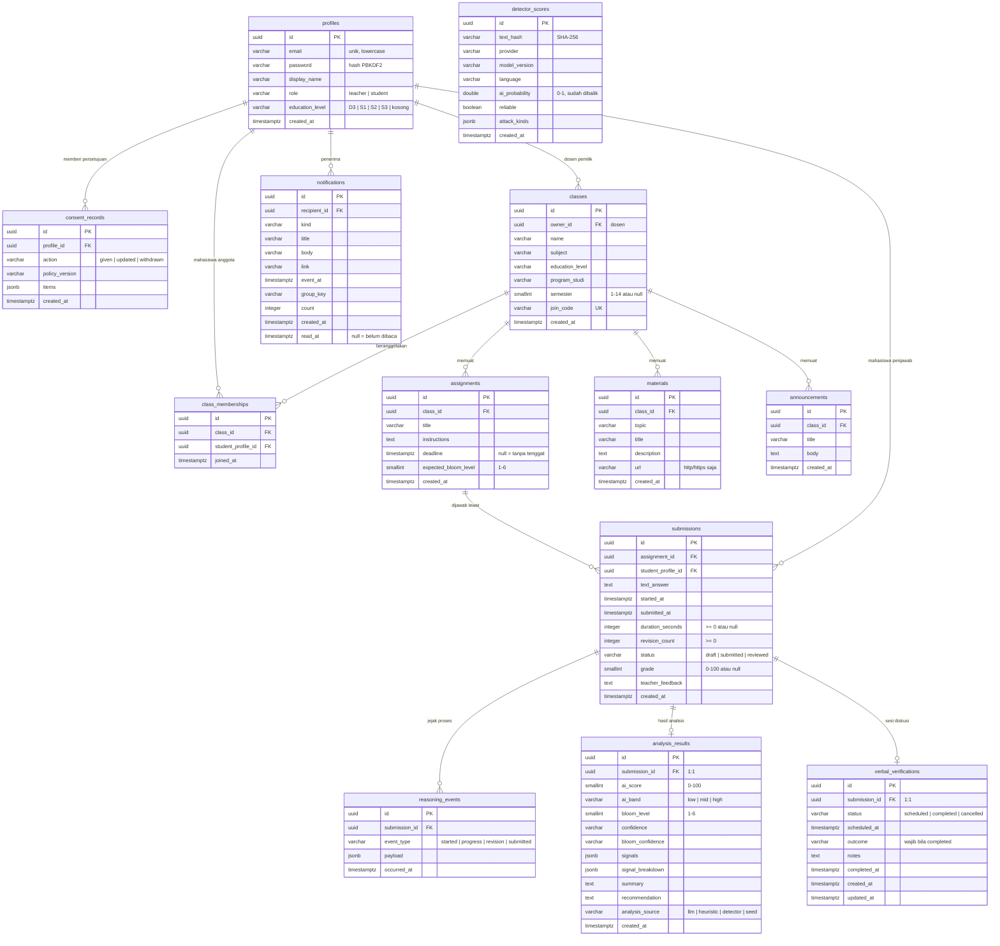
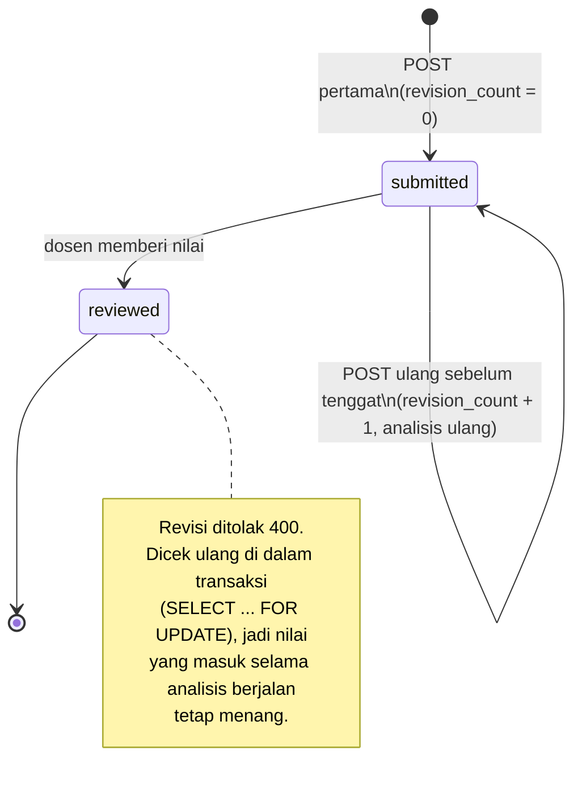

# 08 · ERD dan Kamus Data

Skema PostgreSQL ThinkPath setelah migrasi ke VPS (riwayat migrasi direset ke
`0001_initial` per app pada Oktober 2026). Sumber kebenaran tetap
`backend/apps/*/models.py`; bila model berubah, perbarui berkas ini di PR yang
sama.

Konvensi yang berlaku di semua tabel:

- Kunci primer `id` bertipe **UUID** (dibuat aplikasi, bukan sequence), jadi ID
  tidak bisa ditebak berurutan dari URL.
- Waktu disimpan **UTC** (`timestamptz`). Zona tampilan (Asia/Jakarta) urusan
  frontend.
- Semua foreign key `ON DELETE CASCADE`: menghapus akun menghapus seluruh data
  turunannya, sesuai janji penghapusan di Kebijakan Privasi.
- Aturan bisnis yang penting dijaga **di basis data** (unique/check
  constraint), bukan hanya di serializer, karena dua permintaan serentak bisa
  sama-sama lolos validasi aplikasi.

---

## 8.1 Diagram relasi

`detector_scores` sengaja **tidak berelasi** ke tabel mana pun. Isinya cache
skor detektor berbayar yang dikunci oleh hash teks, sehingga dua jawaban dengan
teks identik berbagi satu skor, dan tidak ada data pribadi yang tersimpan di
sana.

---

## 8.2 Pembagian per app Django

| App | Tabel | Tanggung jawab |
|---|---|---|
| `apps.accounts` | `profiles`, `consent_records` | Identitas, JWT, persetujuan UU PDP |
| `apps.academics` | `classes`, `class_memberships`, `assignments`, `materials`, `announcements`, `submissions`, `reasoning_events`, `verbal_verifications` | Perkuliahan dan pengumpulan |
| `apps.analysis` | `analysis_results`, `detector_scores` | Hasil analisis dan cache detektor |
| `apps.notifications` | `notifications` | Notifikasi per penerima |

Tidak ada tabel bawaan Django (`auth_*`, `django_content_type`, `django_session`).
Identitas dikelola sendiri lewat `profiles`, dan app bawaan itu dilepas dari
`INSTALLED_APPS`. Satu-satunya tabel tambahan adalah `django_migrations`.

---

## 8.3 Constraint dan index

| Tabel | Nama | Jenis | Menjaga apa |
|---|---|---|---|
| `profiles` | `profile_email_ci_unique` | UNIQUE `lower(email)` | Satu akun per email tanpa peduli huruf besar; email juga disimpan lowercase |
| `classes` | `join_code` | UNIQUE | Kode gabung kelas tidak bentrok |
| `classes` | `class_semester_range` | CHECK | Semester 1–14 atau kosong |
| `classes` | `classes_owner_recent_idx` | INDEX `(owner, created_at desc)` | Daftar kelas dosen |
| `class_memberships` | `membership_unique_per_class` | UNIQUE `(class, student)` | Mahasiswa tidak tergabung dua kali |
| `assignments` | `assignment_bloom_level_range` | CHECK | Target Bloom 1–6 |
| `assignments` | `assign_class_recent_idx` | INDEX | Daftar tugas per kelas |
| `submissions` | `submission_unique_per_student` | UNIQUE `(assignment, student)` | **Satu jawaban per mahasiswa per tugas.** Pengumpulan ulang memperbarui baris yang sama; klik ganda tidak lagi membuat baris kembar |
| `submissions` | `submission_grade_range` | CHECK | Nilai 0–100 atau kosong |
| `submissions` | `submission_revision_count_positive`, `submission_duration_positive` | CHECK | Angka proses tidak negatif |
| `submissions` | `sub_assign_recent_idx`, `sub_student_recent_idx`, `sub_assign_status_idx` | INDEX | Daftar per tugas, per mahasiswa, dan antrean "perlu dinilai" |
| `reasoning_events` | `reason_sub_time_idx` | INDEX `(submission, occurred_at)` | Linimasa proses berurutan |
| `verbal_verifications` | `verification_outcome_matches_status` | CHECK | Kesimpulan hanya ada setelah sesi selesai, dan sesi selesai wajib punya kesimpulan |
| `analysis_results` | `analysis_ai_score_range`, `analysis_bloom_level_range` | CHECK | Skor 0–100, Bloom 1–6 |
| `detector_scores` | `detector_score_unique_key` | UNIQUE `(text_hash, provider, model_version, language)` | Teks yang sama tidak dibayar dua kali; menaikkan versi model otomatis membatalkan cache lama |
| `detector_scores` | `detector_probability_range` | CHECK | Probabilitas 0–1 |
| `notifications` | `notif_deadline_once` | UNIQUE parsial `(recipient, group_key) WHERE kind='deadline_soon'` | Pengingat tenggat hanya sekali walau lonceng dimuat serentak |
| `notifications` | `notif_unread_idx` | INDEX parsial `(recipient) WHERE read_at IS NULL` | Hitung "belum dibaca" di setiap halaman tetap murah |
| `consent_records` | `consent_profile_recent_idx` | INDEX `(profile, created_at desc)` | Persetujuan yang berlaku = baris terbaru |

Foreign key juga otomatis mendapat index dari Django.

---

## 8.4 Normalisasi dan denormalisasi yang disengaja

Skema berada di **3NF**, dengan empat pengecualian yang disengaja. Semuanya
dicatat di sini agar tidak "dirapikan" tanpa sadar:

| Kolom | Kenapa tidak dinormalisasi |
|---|---|
| `analysis_results.ai_band` | Bisa diturunkan dari `ai_score`, tetapi ambangnya **berbeda per sumber** (heuristik 42/70, detektor 35/70). Menghitung ulang dari angka saja bisa memberi band yang berbeda dari yang dilihat dosen saat itu. |
| `classes.program_studi`, `materials.topic` | Teks bebas, bukan tabel referensi. Ada kelas lintas prodi dan mata kuliah umum, dan topik hanya dipakai untuk mengelompokkan. Mengubahnya menjadi tabel mengubah kontrak API. |
| `profiles.education_level` | Jenjang yang diisi pengguna di Pengaturan. **Analisis tidak memakainya**; analisis memakai `classes.education_level`. Jenjang melekat di kelas karena semester mahasiswa berubah tiap enam bulan, sedangkan kelas permanen berstatus "semester 3". |
| `reasoning_events.payload`, `analysis_results.signals`/`signal_breakdown` | JSON karena isinya berbeda per jenis event atau per sumber analisis, dan selalu dibaca utuh bersama barisnya. Tidak pernah difilter di SQL. |

Yang **dihapus** saat reset migrasi:

- `assignments.education_level`: duplikat jenjang kelas yang pernah membuat
  tugas S2 tersimpan di kelas S1. Kolom ini sudah lama dibuang dan tidak muncul
  lagi di `0001_initial`.
- Tabel bawaan `auth_*` dan `django_content_type` yang tidak pernah diisi.

---

## 8.5 Siklus hidup satu submission

`draft` ada di pilihan status untuk kompatibilitas tipe frontend, tetapi tidak
pernah ditulis backend.
