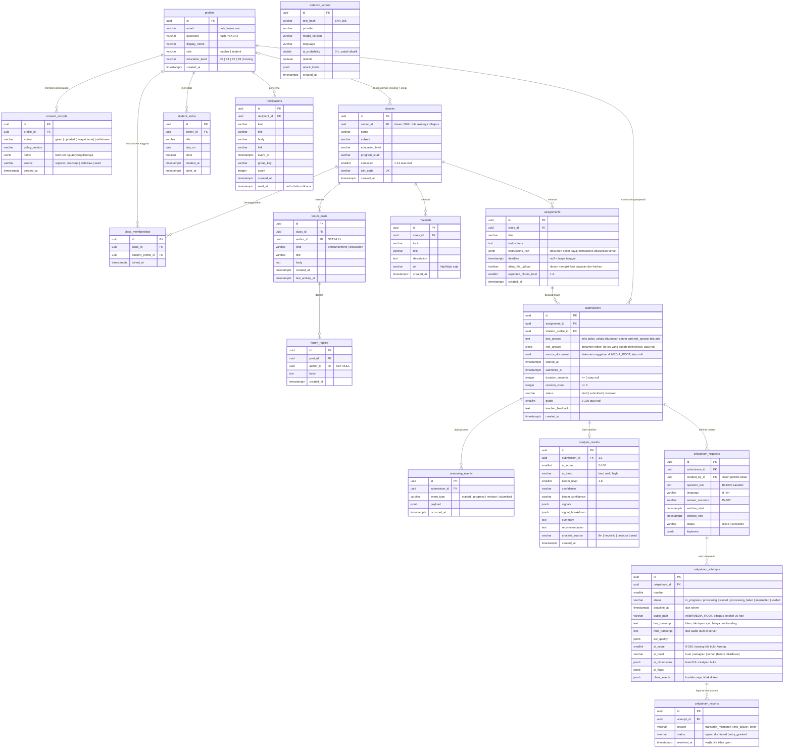
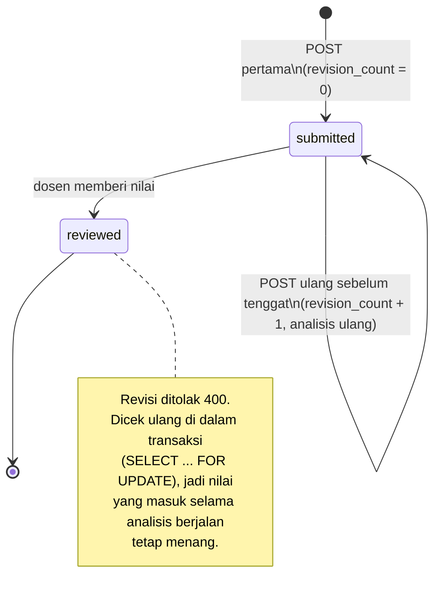

# 08 · ERD dan Kamus Data

Skema PostgreSQL ThinkPath setelah migrasi ke VPS (riwayat migrasi direset ke
`0001_initial` per app pada Oktober 2026). Sumber kebenaran tetap
`backend/apps/*/models.py`; bila model berubah, perbarui berkas ini di PR yang
sama.

Konvensi yang berlaku di semua tabel:

- Kunci primer `id` bertipe **UUID** (dibuat aplikasi, bukan sequence), jadi ID
  tidak bisa ditebak berurutan dari URL.
- Waktu disimpan **UTC** (`timestamptz`). Zona tampilan (Asia/Jakarta) urusan
  frontend.
- Semua relasi `on_delete=CASCADE`: menghapus akun lewat aplikasi menghapus
  seluruh data turunannya, sesuai janji penghapusan di Kebijakan Privasi.
  **Kaskade ini dijalankan ORM Django, bukan constraint PostgreSQL.** Foreign key
  di DB tetap menolak `DELETE` mentah lewat `psql` selama baris anaknya masih
  ada. Hapus lewat aplikasi atau `manage.py shell`, jangan lewat SQL mentah.
- Aturan bisnis yang penting dijaga **di basis data** (unique/check
  constraint), bukan hanya di serializer, karena dua permintaan serentak bisa
  sama-sama lolos validasi aplikasi.

---

## 8.1 Diagram relasi

`detector_scores` sengaja **tidak berelasi** ke tabel mana pun. Isinya cache
skor detektor berbayar yang dikunci oleh hash teks, sehingga dua jawaban dengan
teks identik berbagi satu skor, dan tidak ada data pribadi yang tersimpan di
sana.

---

## 8.2 Pembagian per app Django

| App | Tabel | Tanggung jawab |
|---|---|---|
| `apps.accounts` | `profiles`, `consent_records` | Identitas, JWT, persetujuan UU PDP |
| `apps.academics` | `classes`, `class_memberships`, `assignments`, `materials`, `submissions`, `submission_drafts`, `reasoning_events` | Perkuliahan dan pengumpulan |
| `apps.analysis` | `analysis_results`, `analysis_runs`, `analysis_jobs`, `detector_scores` | Hasil analisis terkini, riwayatnya, antrean worker, dan cache detektor |
| `apps.forum` | `forum_posts`, `forum_replies` | Pengumuman dan diskusi kelas (menggantikan tabel `announcements`; datanya disalin saat migrasi) |
| `apps.todos` | `student_todos` | Checklist pribadi mahasiswa |
| `apps.notifications` | `notifications` | Notifikasi per penerima |
| `apps.cekpaham` | `cekpaham_requests`, `cekpaham_attempts`, `cekpaham_reports` | Tes lisan singkat dan saran skornya |

Tidak ada tabel bawaan Django (`auth_*`, `django_content_type`, `django_session`).
Identitas dikelola sendiri lewat `profiles`, dan app bawaan itu dilepas dari
`INSTALLED_APPS`. Satu-satunya tabel tambahan adalah `django_migrations`.

---

## 8.3 Constraint dan index

| Tabel | Nama | Jenis | Menjaga apa |
|---|---|---|---|
| `profiles` | `profile_email_ci_unique` | UNIQUE `lower(email)` | Satu akun per email tanpa peduli huruf besar; email juga disimpan lowercase |
| `classes` | `join_code` | UNIQUE | Kode gabung kelas tidak bentrok |
| `classes` | `class_semester_range` | CHECK | Semester 1–14 atau kosong |
| `classes` | `classes_owner_recent_idx` | INDEX `(owner, created_at desc)` | Daftar kelas dosen |
| `class_memberships` | `membership_unique_per_class` | UNIQUE `(class, student)` | Mahasiswa tidak tergabung dua kali |
| `assignments` | `assignment_bloom_level_range` | CHECK | Target Bloom 1–6 |
| `assignments` | `assign_class_recent_idx` | INDEX | Daftar tugas per kelas |
| `submissions` | `submission_unique_per_student` | UNIQUE `(assignment, student)` | **Satu jawaban per mahasiswa per tugas.** Pengumpulan ulang memperbarui baris yang sama; klik ganda tidak lagi membuat baris kembar |
| `submissions` | `submission_grade_range` | CHECK | Nilai 0–100 atau kosong |
| `submissions` | `submission_revision_count_positive`, `submission_duration_positive` | CHECK | Angka proses tidak negatif |
| `submissions` | `sub_assign_recent_idx`, `sub_student_recent_idx`, `sub_assign_status_idx` | INDEX | Daftar per tugas, per mahasiswa, dan antrean "perlu dinilai" |
| `reasoning_events` | `reason_sub_time_idx` | INDEX `(submission, occurred_at)` | Linimasa proses berurutan |
| `cekpaham_requests` | `cekpaham_one_active_per_submission` | UNIQUE parsial `(submission) WHERE status='active'` | Satu Cek Paham aktif per jawaban; yang dibatalkan boleh banyak |
| `cekpaham_requests` | `cekpaham_window_order`, `cekpaham_answer_seconds_range` | CHECK | Jendela berakhir setelah mulai; durasi 15–300 dtk (syarat jendela ≥ durasi + 60 dtk divalidasi di service, karena aritmetika datetime tidak portabel di CHECK) |
| `cekpaham_attempts` | `cekpaham_attempt_number`, `cekpaham_one_live_attempt` | UNIQUE, UNIQUE parsial `WHERE status<>'voided'` | Satu sesi berlaku per Cek Paham; sesi baru hanya setelah dosen membatalkan yang lama |
| `cekpaham_attempts` | `cekpaham_attempt_score_range` | CHECK | Skor saran ≤ 100 atau kosong |
| `cekpaham_reports` | `cekpaham_report_resolved_matches_status` | CHECK | Laporan terbuka belum punya waktu penyelesaian, dan sebaliknya |
| `submission_drafts` | `draft_unique_per_student` | UNIQUE `(assignment, student)` | Satu draf per mahasiswa per tugas; `started_at` dan `samples` dicatat **server**, dihapus saat dikumpulkan |
| `analysis_jobs` | `analysis_job_open_idx` | INDEX parsial `status IN (queued, running)` | Klaim job tetap cepat walau riwayat job menumpuk |
| `analysis_runs` | `analysis_run_sub_recent_idx` | INDEX `(submission, -created_at)` | Riwayat analisis per pengumpulan; baris tidak pernah diubah |
| `password_reset_tokens` | `pwreset_profile_recent_idx` | INDEX | Menemukan tautan terbaru satu akun (jeda 60 detik, pencabutan tautan lama) |
| `auth_sessions` | `auth_session_profile_idx` | INDEX | Mencabut semua sesi satu akun |
| `analysis_results` | `analysis_ai_score_range`, `analysis_bloom_level_range` | CHECK | Skor 0–100, Bloom 1–6 |
| `detector_scores` | `detector_score_unique_key` | UNIQUE `(text_hash, provider, model_version, language)` | Teks yang sama tidak dibayar dua kali; menaikkan versi model otomatis membatalkan cache lama |
| `detector_scores` | `detector_probability_range` | CHECK | Probabilitas 0–1 |
| `notifications` | `notif_deadline_once` | UNIQUE parsial `(recipient, group_key) WHERE kind='deadline_soon'` | Pengingat tenggat hanya sekali walau lonceng dimuat serentak |
| `notifications` | `notif_unread_idx` | INDEX parsial `(recipient) WHERE read_at IS NULL` | Hitung "belum dibaca" di setiap halaman tetap murah |
| `consent_records` | `consent_profile_recent_idx` | INDEX `(profile, created_at desc)` | Persetujuan yang berlaku = baris terbaru |

Foreign key juga otomatis mendapat index dari Django.

---

## 8.4 Normalisasi dan denormalisasi yang disengaja

Skema berada di **3NF**, dengan empat pengecualian yang disengaja. Semuanya
dicatat di sini agar tidak "dirapikan" tanpa sadar:

| Kolom | Kenapa tidak dinormalisasi |
|---|---|
| `analysis_results.ai_band` | Bisa diturunkan dari `ai_score`, tetapi ambangnya **berbeda per sumber** (heuristik dan Groq 42/70, detektor Winston 35/70). Menghitung ulang dari angka saja bisa memberi band yang berbeda dari yang dilihat dosen saat itu. |
| `classes.program_studi`, `materials.topic` | Teks bebas, bukan tabel referensi. Ada kelas lintas prodi dan mata kuliah umum, dan topik hanya dipakai untuk mengelompokkan. Mengubahnya menjadi tabel mengubah kontrak API. |
| `profiles.education_level` | Jenjang yang diisi pengguna di Pengaturan. **Analisis tidak memakainya**; analisis memakai `classes.education_level`. Jenjang melekat di kelas karena semester mahasiswa berubah tiap enam bulan, sedangkan kelas permanen berstatus "semester 3". |
| `reasoning_events.payload`, `analysis_results.signals`/`signal_breakdown` | JSON karena isinya berbeda per jenis event atau per sumber analisis, dan selalu dibaca utuh bersama barisnya. Tidak pernah difilter di SQL. |

Yang **dihapus** saat reset migrasi:

- `assignments.education_level`: duplikat jenjang kelas yang pernah membuat
  tugas S2 tersimpan di kelas S1. Kolom ini sudah lama dibuang dan tidak muncul
  lagi di `0001_initial`.
- Tabel bawaan `auth_*` dan `django_content_type` yang tidak pernah diisi.

---

## 8.5 Siklus hidup satu submission

`draft` ada di pilihan status untuk kompatibilitas tipe frontend, tetapi tidak
pernah ditulis backend.

## 8.x Tambahan Oktober 2026 (perbaikan temuan tinggi)

- `submissions.analysis_state` (`pending`/`running`/`done`/`failed`): keadaan analisis, diisi `pending` oleh jalur pengumpulan dan `done` oleh worker. Bawaan `done` agar baris lama/seed tidak tampak menunggu.
- `submission_drafts`: draf dengan jejak pengerjaan yang dicatat server (lihat README backend, "Draf, submit, dan revisi").
- `analysis_results.process_band` / `process_evidence`: pola pengerjaan, bukti tersendiri yang tidak menjumlah ke `ai_score`.
- `analysis_runs`: setiap analisis disimpan permanen (payload lengkap, masukan proses, SHA-256 teks, pemohon). `analysis_results` tetap satu baris terkini.
- `analysis_jobs`: antrean untuk `run_analysis_worker`.
- `auth_sessions`: sesi login yang bisa dicabut; token memuat `sid`.
- `password_reset_tokens`: tautan atur ulang sandi sekali pakai; hanya hash token (`token_hash`) yang disimpan, berlaku 30 menit, `used_at` terisi saat dipakai atau digantikan tautan baru.
- `classes.owner_id` boleh kosong (`ON DELETE SET NULL`): dosen yang menghapus akun meninggalkan kelas sebagai arsip (`owner_left_at`). `cekpaham.created_by_id` juga boleh kosong dengan alasan yang sama.
- `account_deletions`: catatan anonim bahwa sebuah akun dihapus (tanpa id profil, tanpa email).
